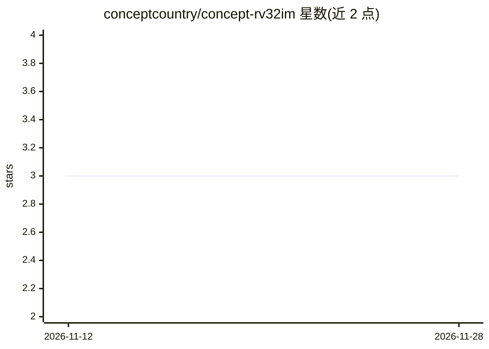

# conceptcountry/concept-rv32im

⭐ 3 · Python · Apache-2.0 · 推送 2026-11-12 · [GitHub](https://github.com/conceptcountry/concept-rv32im) · 个人维护

**将 RV32IM 机器编译进 27B 模型权重的研究工件库**

为论文 *Exact Neural Network Inference Inside the Weights of Qwen Concept 27B* 提供的分析代码、合并工具与评测工件：一个以权重形式存在的 RISC-V RV32IM 解释器，通过 11 个额外层把隐藏态扩宽至 6656 维并用作机器状态，模型靠前向传播执行程序。工件含独立验证（72 个程序 264 万条指令）与 MNIST 分类器在权重内运行的对比结果、发现并修复合并缺陷的探针与补丁工具，以及在 HuggingFace 发布的 bf16/FP8/NVFP4/GGUF 多格式权重。状态为实验性、仍在评估。面向可解释性研究者，复现推理演示需 RISC-V 交叉工具链、QEMU 与 PyTorch。

## 筛选速览

| 维度 | 判定 | 备注 |
|---|---|---|
| AI 角色 | `ai-knowledge` | 知识聚合/清单类 |
| 许可风险 | `permissive` | Apache-2.0 |
| 部署形态 | `None` |  |
| 模型依赖 | local-ok | 支持本地模型 |
| 硬件要求 | — | 无带数字的原话,不猜 |
| 安装摩擦 | `low` | 无编译、无系统依赖或容器化 |
| 成熟度 | `idea` | |

## 能力要点

- 11 个额外层将隐藏态从 5120 扩宽到 6656 作为机器状态，执行靠前向传播
- 独立验证 264 万条指令、合并检查点上 61/61 程序完全一致
- 合并工具含量化探针，发现有损量化网格会破坏机器层，故机器层保持 bf16
- 权重发布 bf16/FP8/NVFP4/GGUF 五种格式并附 SHA256 校验

## 适用场景

- 研究把确定性计算结构编译进语言模型权重的方法
- 复现论文中的推理演示与量化实验
- 研究权重合并对宿主模型文本生成行为的影响

## 场景标签

`模型评测` `模型量化` · 领域:评测与运维

## 证据(README 行号)

> L3: Analysis code, merge tooling, inference demonstrations and evaluation artifacts for
> L17: A RISC-V RV32IM interpreter that exists as weights, not as code the model calls.
> L158: Experimental, under evaluation.

## 星数曲线

2026-11-12 3 → 2026-11-28 3（+0）

---
*卡片 v1 · prompt 1.4 · 生成 2026-11-22 · 置信度 high · 依据 README sha `e766a12812d7` · [字段定义](../../DATASET.md)*
