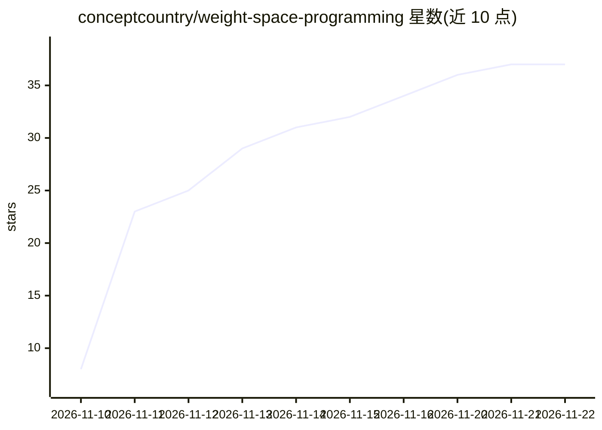

# conceptcountry/weight-space-programming

⭐ 37 · Typst · Apache-2.0 · 推送 2026-11-08 · [GitHub](https://github.com/conceptcountry/weight-space-programming) · 个人维护

**Qwen3.8-27B 无梯度权重编辑的复现分析与评测产物**

一项 norm-matched 受控复现研究的代码与评测产物：对 Qwen3.8-27B 做九层无梯度权重编辑以减少 thinking token（最多降 54% 且准确率未降），并用等范数随机编辑作为对照来区分方向有效性与扰动效应。论文全部数字由 results/ 产物经脚本再生，未手工转录；IFBench 对照区间被报告为 borderline 而非胜出。权重以 bf16/FP8/NVFP4A16/GGUF 等格式发布在自建 registry 与 HuggingFace，量化版本未经单独评测。实验性、评估中。

## 筛选速览

| 维度 | 判定 | 备注 |
|---|---|---|
| AI 角色 | `ai-native` | 本体是模型或模型工具 |
| 许可风险 | `permissive` | Apache-2.0 |
| 部署形态 | `None` |  |
| 模型依赖 | — | README 未给出锁定关系 |
| 硬件要求 | — | 无带数字的原话,不猜 |
| 安装摩擦 | `low` | 无编译、无系统依赖或容器化 |
| 成熟度 | `idea` | |

## 能力要点

- 九层无梯度编辑使 thinking token 最多降 54% 且准确率未降
- 等范数随机编辑对照，区分方向有效性与扰动效应
- 论文全部数字由 results/ 产物经脚本再生，可复现
- 权重以 bf16/FP8/NVFP4A16/Q8_0 等格式发布于 registry 与 HuggingFace

## 适用场景

- 复现论文数字与图表
- 研究 Qwen 系模型的过度思考行为与权重空间干预
- 下载编辑后权重用于部署与进一步评测

## 场景标签

`模型评测` · 领域:评测与运维

## 证据(README 行号)

> L3: Analysis code and evaluation artifacts for *Gradient-Free Weight Editing Reduces
> L11: A nine-layer, gradient-free edit to Qwen3.8-27B that cuts thinking tokens by up

## 星数曲线

2026-11-10 8 → 2026-11-22 37（+29）

---
*卡片 v1 · prompt 1.4 · 生成 2026-11-18 · 置信度 high · 依据 README sha `8caea8f329de` · [字段定义](../../DATASET.md)*
