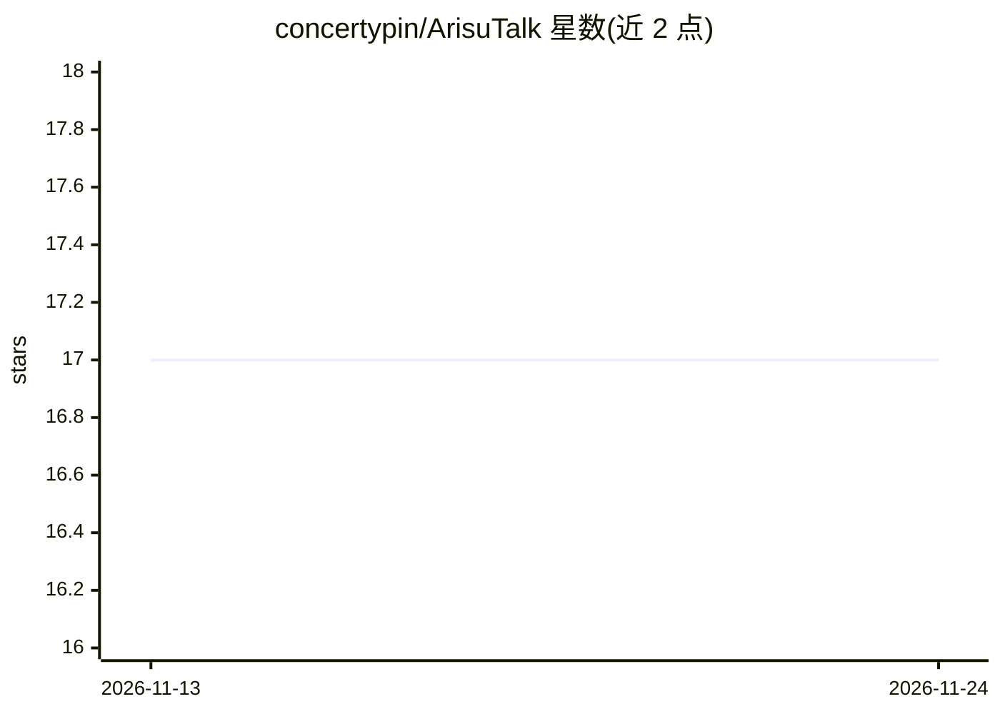

# concertypin/ArisuTalk

⭐ 17 · TypeScript · Apache-2.0 · 推送 2026-11-22 · [GitHub](https://github.com/concertypin/ArisuTalk) · [官网](http://dev.arisutalk.moe/) · 个人维护

**本地优先的多 LLM 角色扮演聊天 Web 应用**

基于 Svelte 5 + Vite 前端与 Hono（部署于 Cloudflare Workers）后端的角色扮演聊天应用。功能包括角色编辑器（设定、背景、说话方式）、Markdown 渲染的聊天界面，以及使用 Dexie.js 的本地优先架构，数据保存在用户设备上。AI 部分通过 LangChain 接入多个 LLM。README 主要公告为前端重构计划 Project Kei，当前默认分支为 kei，main 分支保持原状；运行方式为 git clone 后用 pnpm 分别启动前后端。

## 筛选速览

| 维度 | 判定 | 备注 |
|---|---|---|
| AI 角色 | `ai-native` | 本体是模型或模型工具 |
| 许可风险 | `permissive` | Apache-2.0 |
| 部署形态 | `library` | 以包/库形式分发 |
| 模型依赖 | — | README 未给出锁定关系 |
| 硬件要求 | — | 无带数字的原话,不猜 |
| 安装摩擦 | `low` | 无编译、无系统依赖或容器化 |
| 成熟度 | `idea` | |

## 能力要点

- 角色编辑器：可定义角色的设定、背景与说话方式
- 本地优先架构（Dexie.js），数据存储在用户设备
- 技术栈：Svelte 5 + Vite 前端、Hono on Cloudflare Workers 后端、LangChain 接入 LLM

## 适用场景

- 在浏览器中进行 AI 角色扮演聊天
- 自定义角色设定与背景后进行沉浸式对话
- 在本地设备保存聊天数据

## 场景标签

`聊天机器人` · 领域:对话与助手

## 证据(README 行号)

> L5: Hiya! Welcome to **ArisuTalk**! ✨ This is where your AI roleplay dreams come to life! 💖
> L24: * **Advanced Character Editor:** Define every little detail of your characters! Lore, backstory, speech patterns—yo
> L31: * **AI:** LangChain 🧠

## 星数曲线

2026-11-13 17 → 2026-11-24 17（+0）

---
*卡片 v1 · prompt 1.4 · 生成 2026-11-18 · 置信度 high · 依据 README sha `252fca35cd7d` · [字段定义](../../DATASET.md)*
