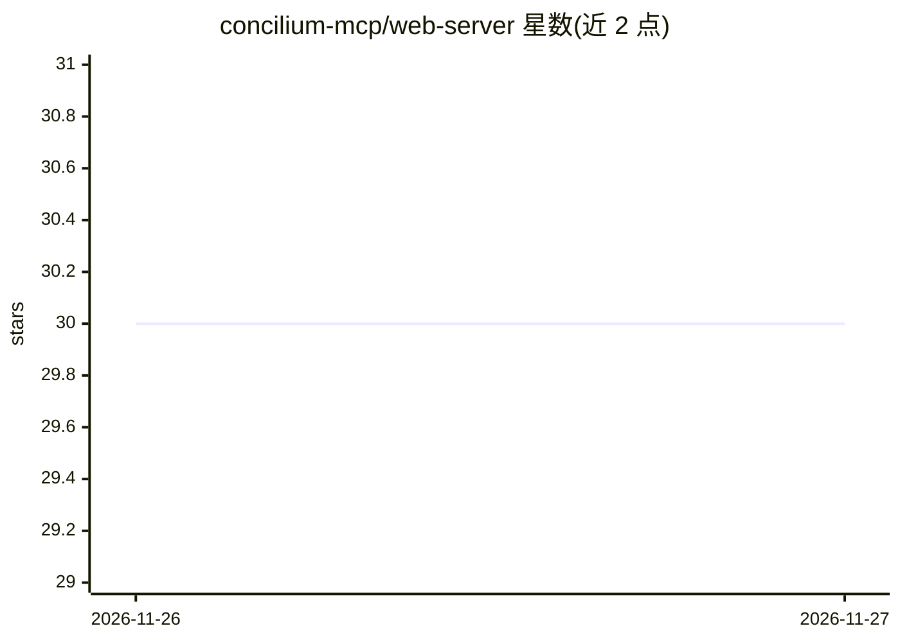

# concilium-mcp/web-server

⭐ 30 · Python · Apache-2.0 · 推送 2026-11-25 · [GitHub](https://github.com/concilium-mcp/web-server) · 组织维护

**自托管 AI 代理知识库：笔记、看板与代理记忆经 MCP 读写**

基于 FastAPI、PostgreSQL 与 pgvector 的自托管知识库，面向使用 AI 代理的团队。团队成员在 Web 工作区写笔记（嵌套文件夹、wikilinks、版本历史、PDF/Word/OCR 导入），保存时自动分块嵌入索引；代理经 MCP 或 REST API 查询、插入、更新知识，带重复检测与外部 id upsert。代理拥有配置、持久记忆与会话摘要，load_agent 可在新会话恢复上下文。嵌入提供方可在 Voyage/OpenAI/HuggingFace/本地模型间切换，reindex 重算向量。需 Python 3.11+、uv、PostgreSQL 16 与 pgvector 扩展。

## 筛选速览

| 维度 | 判定 | 备注 |
|---|---|---|
| AI 角色 | `ai-ecosystem` | LLM/agent 周边工具 |
| 许可风险 | `permissive` | Apache-2.0 |
| 部署形态 | `self-host` | docker 或自建部署 |
| 模型依赖 | locked-api |  |
| 硬件要求 | — | 无带数字的原话,不猜 |
| 安装摩擦 | `low` | 无编译、无系统依赖或容器化 |
| 成熟度 | — | 结构信号不足 |

## 能力要点

- PostgreSQL + pgvector 上的语义+全文混合搜索，保存即分块嵌入
- 代理注册表：系统提示、作用域、持久记忆与会话任务，经 MCP 读写
- 代理提议配置变更、人工批准的治理机制
- 文件夹级 Kanban 看板，代理以 2 小时租约认领卡片协作

## 适用场景

- 团队与 Claude/Codex 等代理共享同一份可读写知识库
- 给代理配置跨会话延续的记忆与项目简报
- 多个代理并行开发时用看板认领和交接任务
- 导入 Obsidian vault 或 PDF/Word 文档供代理语义检索

## 场景标签

`Agent 记忆` `知识库管理` `语义搜索` · 领域:Agent 开发

## 证据(README 行号)

> L5:  The open-source, self-hosted knowledge base for AI agents.
> L23: **Concilium is a real RAG backend, not an Obsidian vault with `.md` files.** Your team writes notes in a clean web 
> L25: Agents also get a home: a profile (system prompt), persistent memory, session summaries and tasks, all stored in th

## 星数曲线

2026-11-26 30 → 2026-11-27 30（+0）

---
*卡片 v1 · prompt 1.4 · 生成 2026-11-26 · 置信度 high · 依据 README sha `720471f67e61` · [字段定义](../../DATASET.md)*
