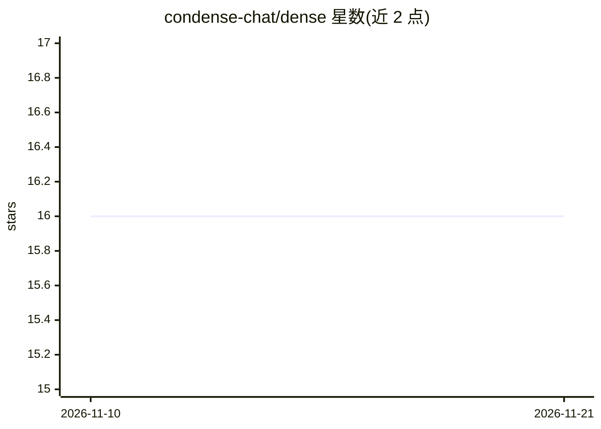

# condense-chat/dense

⭐ 16 · Rust · MIT · 推送 2026-11-12 · [GitHub](https://github.com/condense-chat/dense) · [官网](https://condense.chat) · 组织维护

**压缩编码 agent 上下文的 CLI 代理：为 Claude Code 等省 token**

dense 是 Condense 的开源 CLI：启动 Claude Code、Codex 或 OpenCode 编码 agent，并将其模型请求路由到 Condense 托管的压缩代理，压缩会话中重复的文件读取、diff 与测试日志等上下文。支持按需启动（dense claude 等）或持久接管（dense persist）惯用启动命令；提供 dense info/usage 查看每会话及累计的 token 与成本节省。工作依赖 Condense 托管代理并需登录，请求内容默认闲置 7 天后删除。

## 筛选速览

| 维度 | 判定 | 备注 |
|---|---|---|
| AI 角色 | `ai-ecosystem` | LLM/agent 周边工具 |
| 许可风险 | `permissive` | MIT |
| 部署形态 | `None` |  |
| 模型依赖 | — | README 未给出锁定关系 |
| 硬件要求 | — | 无带数字的原话,不猜 |
| 安装摩擦 | `medium` | 含编译或系统依赖之一 |
| 成熟度 | — | 结构信号不足 |

## 能力要点

- 通过托管压缩代理路由编码 agent 的模型请求
- 支持 Claude Code、Codex、OpenCode 三种 agent
- dense info/usage 输出每会话与累计 token 节省及成本估算
- 提供离线 benchmark 回放脚本（minmax-bench）

## 适用场景

- 长调试会话中减少重复上下文发送以节省 token
- 在 Claude 订阅额度内查看压缩带来的用量差异
- 按需或持久地让既有编码 agent 走压缩代理

## 场景标签

`模型网关` · 领域:Agent 开发

## 证据(README 行号)

> L5: **Use fewer tokens in Claude Code, Codex, and OpenCode.** A long debugging session can send the same file reads, dif
> L37: Try a task you can verify. For example, open a project with a failing test and ask the agent to find the cause, fix

## 星数曲线

2026-11-10 16 → 2026-11-21 16（+0）

---
*卡片 v1 · prompt 1.4 · 生成 2026-11-18 · 置信度 high · 依据 README sha `9701521a876c` · [字段定义](../../DATASET.md)*
