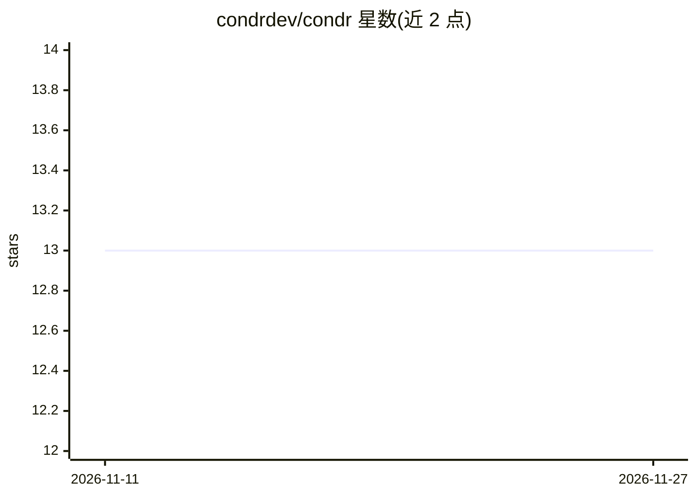

# condrdev/condr

⭐ 13 · Rust · Apache-2.0 · 推送 2026-11-25 · [GitHub](https://github.com/condrdev/condr) · [官网](https://condr.dev) · 个人维护

**统一窗口运行与管理多个 AI 编码 agent 的应用**

Condr 由 Server 与 Client 两部分组成：Server 后台托管终端进程与各 agent 的状态，断开窗口或网络后任务继续运行；Client 是 Rust 编写的原生桌面应用，可连接并管理多个 Server。在一个窗口中并排运行 Claude Code、Codex 及任意命令行程序，支持本地与远程机器，提供 SSH、TCP、零配置 P2P NAT 穿透三种连接方式，侧栏显示各 agent 状态并在任务完成时通知，另有 iOS/Android 移动端可查看与回复。面向需要并行管理多个 agent 的开发者。

## 筛选速览

| 维度 | 判定 | 备注 |
|---|---|---|
| AI 角色 | `ai-ecosystem` | LLM/agent 周边工具 |
| 许可风险 | `permissive` | Apache-2.0 |
| 部署形态 | `desktop` | 安装包/桌面程序 |
| 模型依赖 | — | README 未给出锁定关系 |
| 硬件要求 | — | 无带数字的原话,不猜 |
| 安装摩擦 | `low` | 无编译、无系统依赖或容器化 |
| 成熟度 | `idea` | |

## 能力要点

- Server 常驻托管 agent 状态，断线后可恢复继续
- SSH/TCP/P2P（含 NAT 穿透）连接远程设备，流量端到端加密
- 基于 Ghostty libghostty-vt 的真实终端，Rust 原生无 Electron
- 移动端 App 可远程查看与回复任意终端面板

## 适用场景

- 在一个窗口中并行运行和管理多个编码 agent
- 把长任务放到远程服务器上跑，本地断开不中断
- 用手机随时查看 agent 进度并回复提问

## 场景标签

`编码 Agent` · 领域:编码与开发

## 证据(README 行号)

> L18: Condr is a lightweight app built for running many agents together and managing their terminals. Run Claude Code, Co
> L22: - **Server**: a service that stays running in the background. It hosts every terminal process and every agent's sta
> L30: - **Agent driven** — Agents can drive Condr in turn: create panes on their own, hand out tasks across panes, and ta

## 星数曲线

2026-11-11 13 → 2026-11-27 13（+0）

---
*卡片 v1 · prompt 1.4 · 生成 2026-11-18 · 置信度 high · 依据 README sha `6deba9f5ea09` · [字段定义](../../DATASET.md)*
