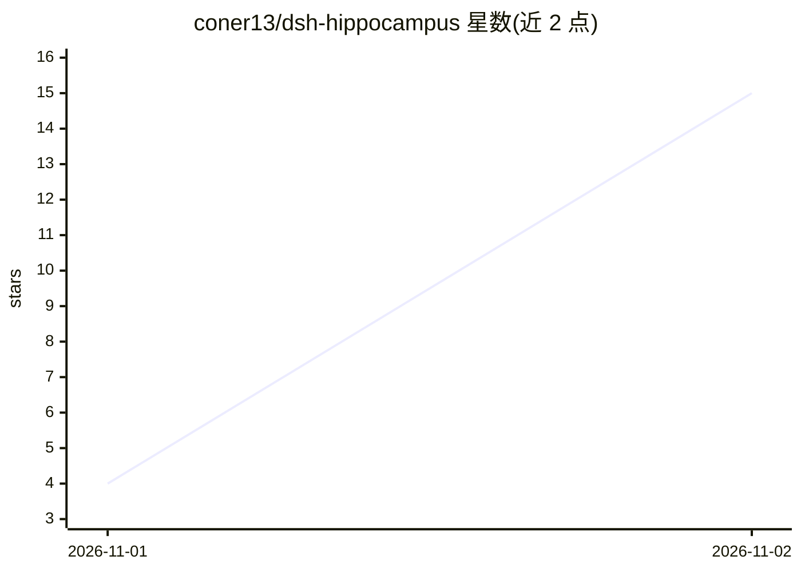

# coner13/dsh-hippocampus

⭐ 15 · JavaScript · MIT · 推送 2026-11-01 · [GitHub](https://github.com/coner13/dsh-hippocampus) · 个人维护 · 中文 README

**为 DSH 提供“自动记、按线索想、会变淡”的长期记忆插件**

DeepSeek Harness（DSH）的会话长期记忆插件：每一轮对话与工具调用自动落盘到只增不改的原始流 stream.jsonl，索引、显著度等派生数据均可删除重算；每轮按 BM25+中文分词召回最多 3 条相关旧事，久远记忆按可配半衰期降权但原话不删。数据全部本地、不联网。依赖 DSH 宿主注入，无向量检索，Windows 路径优先测试。通过软链挂载进 DSH profile 安装。

## 筛选速览

| 维度 | 判定 | 备注 |
|---|---|---|
| AI 角色 | `ai-ecosystem` | LLM/agent 周边工具 |
| 许可风险 | `permissive` | MIT |
| 部署形态 | `None` |  |
| 模型依赖 | — | README 未给出锁定关系 |
| 硬件要求 | — | 无带数字的原话,不猜 |
| 安装摩擦 | `low` | 无编译、无系统依赖或容器化 |
| 成熟度 | `idea` | |

## 能力要点

- 每轮对话与工具调用自动落盘，只增不改的原始流存储
- BM25+中文分词按线索召回，每轮最多浮 3 条
- 半衰期可配的记忆降权，原始记录不删除
- 数据全本地、离线、零出网

## 适用场景

- 给 DSH 会话补上跨会话的长期记忆
- 保留原始对话与工具调用记录以便回溯
- 多身份/群聊场景下分线隔离记忆

## 场景标签

`Agent 记忆` · 领域:Agent 开发

## 证据(README 行号)

> L3: 给 DeepSeek Harness（DSH）里的会话一份**会变淡但不会说谎**的长期记忆。
> L5: DSH 的会话本身没有跨会话记忆：上下文一压、窗口一关，前面聊过的东西就没了。
> L93: - **依赖 DSH。** 它不是独立程序，要 DSH 宿主注入才能跑。没有 DSH 装不起来。

## 星数曲线

2026-11-01 4 → 2026-11-02 15（+11）

---
*卡片 v1 · prompt 1.4 · 生成 2026-11-02 · 置信度 high · 依据 README sha `36a1986df109` · [字段定义](../../DATASET.md)*
