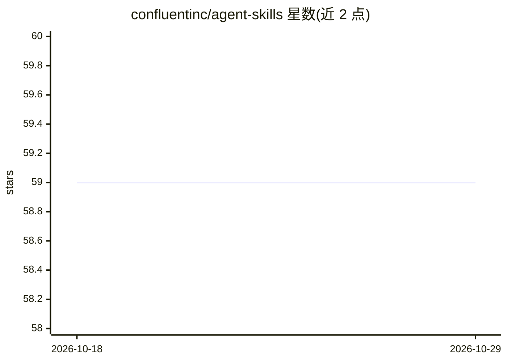

# confluentinc/agent-skills

⭐ 59 · Python · Apache-2.0 · 推送 2026-10-27 · [GitHub](https://github.com/confluentinc/agent-skills) · 组织维护

**面向流处理开发者的 AI agent 技能集（Kafka/Flink 代码生成）**

Confluent 维护的 AI 技能集合，供 Claude、Cursor 等编程助手加载，帮助开发者构建生产级 Kafka 生产者、Flink 应用与实时数据管道。技能按请求自动激活，覆盖 Flink UDF 开发、Schema Registry 迁移与治理、Kafka Streams 编程、Java/Python 客户端脚手架、CDC 管道、Flink SQL 方言调试、MSK 迁移评估、调优建议等，并含技能创建与审计工具。安装方式为 Claude 插件市场命令或 npx skills CLI。README 提示模型输出具有非确定性，生成代码需开发者审查测试。

## 筛选速览

| 维度 | 判定 | 备注 |
|---|---|---|
| AI 角色 | `ai-knowledge` | 知识聚合/清单类 |
| 许可风险 | `permissive` | Apache-2.0 |
| 部署形态 | `library` | 以包/库形式分发 |
| 模型依赖 | — | README 未给出锁定关系 |
| 硬件要求 | — | 无带数字的原话,不猜 |
| 安装摩擦 | `low` | 无编译、无系统依赖或容器化 |
| 成熟度 | — | 结构信号不足 |

## 能力要点

- 11 个技能覆盖 Kafka/Flink/CDC/调优等流处理开发场景
- 技能按用户请求自动激活，无需手动切换
- 通过 Claude 插件市场或 npx skills CLI 安装，支持多种 agent
- 内置技能创建器（confluent-skill-creator）与审计器（confluent-skill-reviewer）

## 适用场景

- 让编程助手按 Confluent 最佳实践生成 Kafka/Flink 项目代码
- 扫描存量 Kafka 应用并规划 Schema Registry 迁移
- 排查 Flink SQL 方言差异与 Kafka Streams 生产问题
- 评估 AWS MSK 向 Confluent Cloud 的迁移路径

## 场景标签

`代码生成` · 领域:编码与开发

## 证据(README 行号)

> L3: A collection of AI skills for developing data streaming applications and pipelines with Confluent. These skills help
> L44: This repository includes the following skills:

## 星数曲线

2026-10-18 59 → 2026-10-29 59（+0）

---
*卡片 v1 · prompt 1.4 · 生成 2026-10-24 · 置信度 high · 依据 README sha `dbc12eb550c3` · [字段定义](../../DATASET.md)*
