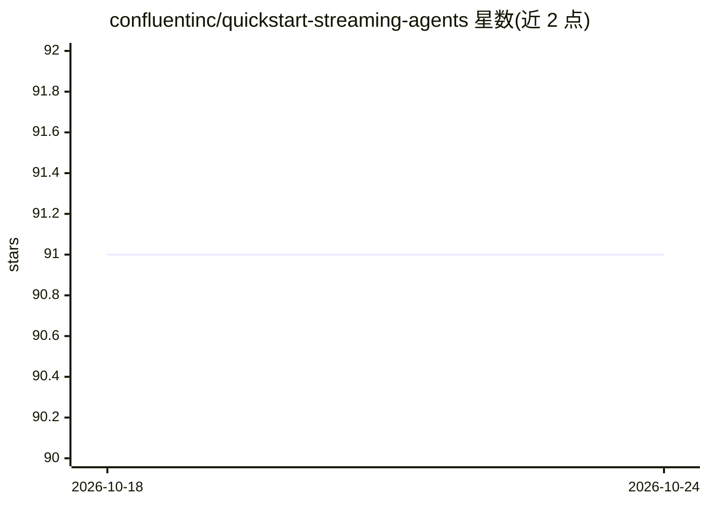

# confluentinc/quickstart-streaming-agents

⭐ 91 · Python · Apache-2.0 · 推送 2026-10-23 · [GitHub](https://github.com/confluentinc/quickstart-streaming-agents) · [官网](https://confluent.io/product/streaming-agents/) · 组织维护

**Confluent Cloud 上构建流式 AI agent 的动手实验快速入门**

Confluent 提供的官方 quickstart 仓库，含四个动手实验：MCP 工具调用的实时价格匹配 agent、Flink 向量搜索与 RAG 流水线、船队管理的 agentic 演示，以及保险理赔实时欺诈检测。实验基于 Confluent Cloud Streaming Agents（运行于 Apache Flink 与 Kafka 之上），使用 Agent Definition（CREATE AGENT）语法与 MCP 工具调用。LLM 提供方需 AWS Bedrock 或 Azure OpenAI API key（支持 BYOK）；部署依赖 Confluent CLI、Terraform、uv、Docker 等工具，通过 uv run deploy 一键部署。

## 筛选速览

| 维度 | 判定 | 备注 |
|---|---|---|
| AI 角色 | `ai-ecosystem` | LLM/agent 周边工具 |
| 许可风险 | `permissive` | Apache-2.0 |
| 部署形态 | `None` |  |
| 模型依赖 | locked-api |  |
| 硬件要求 | — | 无带数字的原话,不猜 |
| 安装摩擦 | `low` | 无编译、无系统依赖或容器化 |
| 成熟度 | — | 结构信号不足 |

## 能力要点

- 4 个实验：MCP 工具调用、RAG 向量搜索、agentic 舰队管理、保险欺诈检测
- 使用 Agent Definition（CREATE AGENT）语法定义 agent
- 支持 AWS Bedrock / Azure OpenAI 作为 LLM 提供方（或 BYOK）
- uv run deploy 一键部署，uv run destroy 一键清理

## 适用场景

- 学习在 Flink/Kafka 上构建事件驱动的实时 AI agent
- 搭建带 MCP 工具调用与向量搜索的流式 RAG 演示
- 参考 Confluent Cloud 上 agent 的 Terraform 部署方式

## 场景标签

`RAG` `教程课程` · 领域:知识与检索

## 证据(README 行号)

> L9: Build real-time AI agents with Confluent Cloud Streaming Agents. This quickstart includes three hands-on labs:
> L20:  Lab3 - Agentic Fleet Management Using Confluent Intelligence

## 星数曲线

2026-10-18 91 → 2026-10-24 91（+0）

---
*卡片 v1 · prompt 1.4 · 生成 2026-10-23 · 置信度 high · 依据 README sha `dcd5728bc53d` · [字段定义](../../DATASET.md)*
