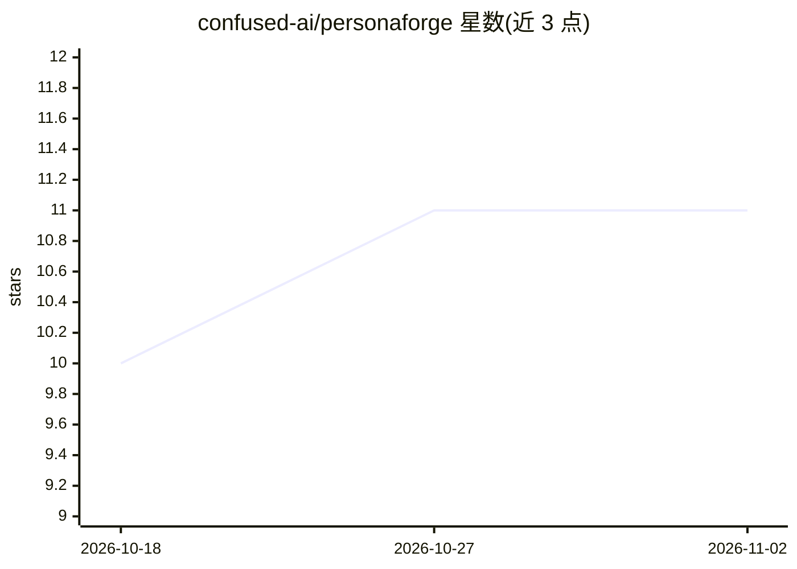

# confused-ai/personaforge

⭐ 11 · TypeScript · MIT · 推送 2026-09-25 · [GitHub](https://github.com/confused-ai/personaforge) · [官网](https://confused-ai.github.io/personaforge/) · 组织维护

**TypeScript 多智能体框架：单包提供编排、护栏、评测与控制台**

以 npm 单包发布的 TypeScript AI agent 框架，面向构建生产级多智能体系统的开发者。提供 ReAct 运行时、30+ 原生 LLM 提供商（经 AI SDK 适配器可达 300+）、120+ 内置工具、8 种多智能体编排模式、DAG 图引擎与事件溯源回放；生产控制包括护栏、HITL 中断恢复、预算与限流、熔断，另含 RAG 引擎、企业网关与 AgentOS 控制台面板。README 以对比表自称 LangChain/CrewAI/LangGraph 等框架的替代选项，MIT 许可。

## 筛选速览

| 维度 | 判定 | 备注 |
|---|---|---|
| AI 角色 | `ai-ecosystem` | LLM/agent 周边工具 |
| 许可风险 | `permissive` | MIT |
| 部署形态 | `library` | 以包/库形式分发 |
| 模型依赖 | local-ok | 支持本地模型 |
| 硬件要求 | — | 无带数字的原话,不猜 |
| 安装摩擦 | `low` | 无编译、无系统依赖或容器化 |
| 成熟度 | — | 结构信号不足 |

## 能力要点

- 8 种多智能体编排模式（Supervisor/Swarm/Consensus/Handoff 等）
- DAG 图引擎与事件溯源：append-only 日志、确定性重放、哈希链审计
- 生产安全层：护栏、HITL、预算上限、限流、熔断、幂等
- 内置 AgentOS 控制台面板与会话/评测/轨迹/审批可视化

## 适用场景

- 用 TypeScript 构建并服务多智能体工作流
- 为 agent 系统加护栏、预算控制与审计日志
- 通过回放与评测基线检测 agent 回归
- 从 LangChain/CrewAI/LangGraph 迁移到 TypeScript 技术栈

## 场景标签

`Agent 框架` `多智能体` `RAG` `模型评测` · 领域:Agent 开发

## 证据(README 行号)

> L5:  Ship production AI agents in TypeScript.
> L55: - **30+ LLM providers (native) + 300+ via AI SDK adapter** — OpenAI, Anthropic, Google Gemini, AWS Bedrock, Ollama,

## 星数曲线

2026-10-18 10 → 2026-11-02 11（+1）

---
*卡片 v1 · prompt 1.4 · 生成 2026-11-02 · 置信度 high · 依据 README sha `bf8a349bf801` · [字段定义](../../DATASET.md)*
