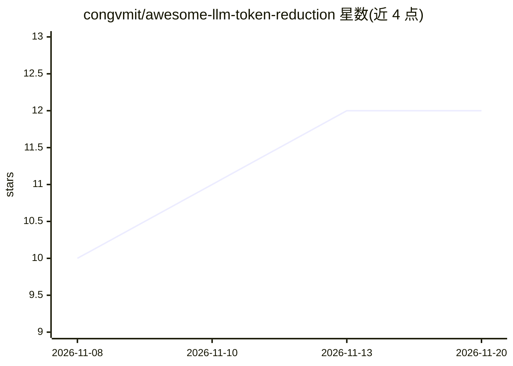

# congvmit/awesome-llm-token-reduction

⭐ 12 · CC0-1.0 · 推送 2026-06-13 · [GitHub](https://github.com/congvmit/awesome-llm-token-reduction) · 个人维护

**降低 LLM token 用量的技术、工具与论文清单**

面向 AI 编码助手的 token 削减主题聚合清单：按提示压缩、编码助手省 token 工具、token 高效数据格式、上下文与记忆管理、输出压缩、研究方法等类别收录代理、插件、hook、MCP 服务器、SDK 与论文条目，每条附一句话说明，聚焦 Claude Code、Codex、Copilot 等编码场景。以 CC0-1.0 许可发布，接受社区 PR 贡献。

## 筛选速览

| 维度 | 判定 | 备注 |
|---|---|---|
| AI 角色 | `ai-knowledge` | 知识聚合/清单类 |
| 许可风险 | `viral` | CC0-1.0 |
| 部署形态 | `None` |  |
| 模型依赖 | — | README 未给出锁定关系 |
| 硬件要求 | — | 无带数字的原话,不猜 |
| 安装摩擦 | `low` | 无编译、无系统依赖或容器化 |
| 成熟度 | — | 结构信号不足 |

## 能力要点

- 按 6+ 类别组织工具、库、数据格式与论文条目
- 收录 drop-in 代理、插件、hook 与 MCP 服务器
- 含 LLMLingua 系列等提示压缩研究与 Microsoft 工具链
- CC0-1.0 许可，欢迎 PR 贡献

## 适用场景

- 为编码助手寻找压缩上下文以节省 token 的工具
- 调研 prompt compression 领域的论文与方法
- 为 LLM 应用选型 token 高效的数据编码格式

## 场景标签

`精选清单` · 领域:学习与行业

## 证据(README 行号)

> L3: > A curated list of techniques, tools, and research for reducing LLM token usage — with a focus on AI coding assista
> L7: ## Contents

## 星数曲线

2026-11-08 10 → 2026-11-20 12（+2）

---
*卡片 v1 · prompt 1.4 · 生成 2026-11-18 · 置信度 high · 依据 README sha `e6582548ee3c` · [字段定义](../../DATASET.md)*
