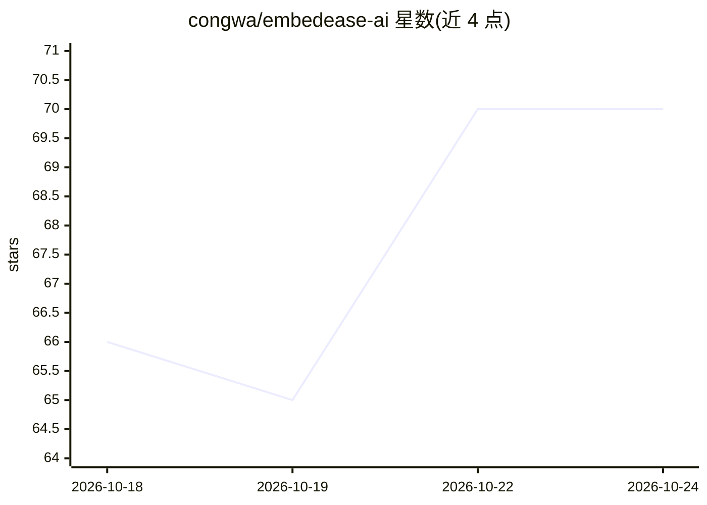

# congwa/embedease-ai

⭐ 70 · Python · 推送 2026-10-19 · [GitHub](https://github.com/congwa/embedease-ai) · [官网](https://embedease-ai.sub2.org/) · 个人维护 · 中文 README

**面向网站的可嵌入 AI 智能客服与商品推荐系统**

自托管的 AI 客服系统：通过对话为用户推荐商品、解答 FAQ、检索知识库，支持四种 Agent 类型与多 Agent 编排（Supervisor 路由）。提供管理后台（商品/爬虫/会话/技能/提示词管理）、一行代码嵌入任意网站的悬浮客服组件、人工客服工作台与企业微信/Webhook 实时推送。记忆系统包含用户画像、事实记忆与知识图谱。部署方式为 Docker 一键安装（内置 Qdrant 向量库）或 Python+Node.js 本地开发，需自备 LLM API Key，可切换 OpenAI/DeepSeek/SiliconFlow/Anthropic 等服务商。

## 筛选速览

| 维度 | 判定 | 备注 |
|---|---|---|
| AI 角色 | `ai-native` | 本体是模型或模型工具 |
| 许可风险 | `none` | — |
| 部署形态 | `self-host` | docker 或自建部署 |
| 模型依赖 | locked-api |  |
| 硬件要求 | — | 无带数字的原话,不猜 |
| 安装摩擦 | `low` | 无编译、无系统依赖或容器化 |
| 成熟度 | — | 结构信号不足 |

## 能力要点

- 四种 Agent 类型（商品推荐/FAQ/知识库/自定义），支持多 Agent 编排
- 一行代码嵌入任意网站的悬浮客服组件
- 人工客服接入与企业微信/Webhook 实时推送、会话热度排序
- 记忆系统：用户画像 + 事实记忆 + 知识图谱

## 适用场景

- 电商网站嵌入 AI 客服，按自然语言需求推荐商品
- 匿名用户咨询时通过企业微信推送通知，人工客服一键接管
- 企业内部知识库问答与 FAQ 售后支持

## 场景标签

`聊天机器人` `文档问答` `推荐系统` · 领域:对话与助手

## 证据(README 行号)

> L29: **EmbedeaseAI Agent** 是一个**智能商品推荐系统**，就像你网站上的"金牌客服"：
> L31: - 🛒 **用户说需求，AI 帮你找商品** — 输入"3000 元以内的轻薄本"，立刻推荐匹配商品
> L43: |🔍 **找商品**|告诉 AI "我想买降噪耳机"，它会帮你搜索并推荐|

## 星数曲线

2026-10-18 66 → 2026-10-24 70（+4）

---
*卡片 v1 · prompt 1.4 · 生成 2026-10-24 · 置信度 high · 依据 README sha `bd0180627014` · [字段定义](../../DATASET.md)*
