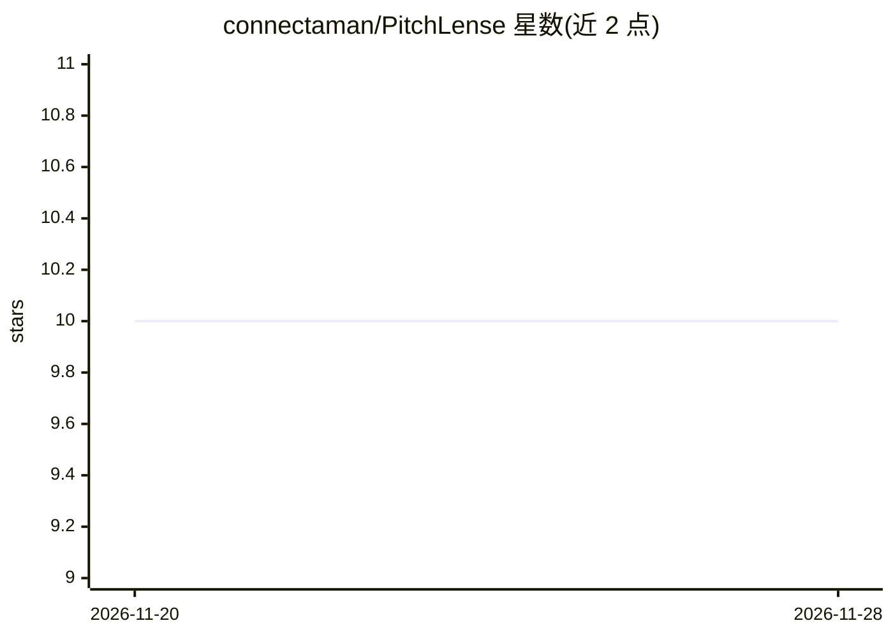

# connectaman/PitchLense

⭐ 10 · HTML · MIT · 推送 2026-01-13 · [GitHub](https://github.com/connectaman/PitchLense) · [官网](https://pitchlense.com) · 组织维护

**为早期创业项目提供 AI 风险评估与增长潜力分析的平台**

面向投资人、创始人和利益相关方的创业项目分析平台：读取路演材料、通话录音、创始人资料、新闻等多类文档，使用 Google Gemini 生成包含 1-10 评分与多维风险评估的分析报告，并支持会议转录摘要、Gmail 邮件分析、投资组合跟踪与 PDF/PPTX 导出。架构基于 Google Cloud（Cloud Run、Cloud SQL、Vertex AI），要求配置 Gemini、FMP 等多个 API key 及 MySQL 数据库方可运行。

## 筛选速览

| 维度 | 判定 | 备注 |
|---|---|---|
| AI 角色 | `ai-native` | 本体是模型或模型工具 |
| 许可风险 | `permissive` | MIT |
| 部署形态 | `library` | 以包/库形式分发 |
| 模型依赖 | — | README 未给出锁定关系 |
| 硬件要求 | — | 无带数字的原话,不猜 |
| 安装摩擦 | `low` | 无编译、无系统依赖或容器化 |
| 成熟度 | — | 结构信号不足 |

## 能力要点

- 多文档分析：路演稿、会议录音、创始人档案等生成风险评估报告
- 会议录音自动转录与 AI 摘要，可导出并邮件分享
- 报告问答聊天，附置信度评分、幻觉检测与来源引用校验
- Chrome 扩展可在网页与 Gmail 中一键分析 pitch

## 适用场景

- 投资前对早期创业项目做多维风险与增长潜力评估
- 分析创始人 LinkedIn 资料生成创始人评分报告
- 从 Gmail 收件箱中的 pitch 邮件批量提取并生成分析报告

## 场景标签

`文档问答` · 领域:知识与检索

## 证据(README 行号)

> L6: PitchLense is a comprehensive AI-powered startup analysis platform that provides detailed risk assessment and growth
> L35: - **AI Layer**: Vertex AI, Gemini, Vision API, Natural Language API
> L65: - **AI-Powered Report Generation**: Automated analysis using Google Gemini AI

## 星数曲线

2026-11-20 10 → 2026-11-28 10（+0）

---
*卡片 v1 · prompt 1.4 · 生成 2026-11-20 · 置信度 high · 依据 README sha `38982ac641db` · [字段定义](../../DATASET.md)*
