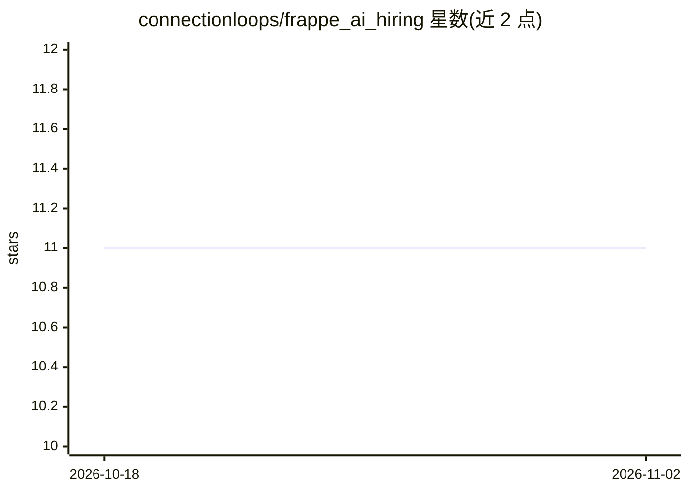

# connectionloops/frappe_ai_hiring

⭐ 11 · Python · MIT · 推送 2026-01-06 · [GitHub](https://github.com/connectionloops/frappe_ai_hiring) · 组织维护

**基于 Frappe/ERPNext 的 AI 招聘自动化应用，覆盖简历筛选到面试准备**

构建于 Frappe Framework 并集成 ERPNext HRMS 的招聘管理应用：从 PDF/DOCX/TXT 简历中抽取结构化数据，按职位要求对候选人评分与推荐入围，生成个性化问卷并对答案做加权评估，产出面试简报。候选人流程覆盖 13 个阶段，含邮件通知、分析与 REST API。AI 能力通过 OpenAI 兼容端点提供（OpenAI/Azure/Ollama），后台任务经 Redis 队列执行；PII 在调用 LLM 前脱敏，AI 仅输出建议、最终决定由人做出。以 bench 命令安装到 Frappe 站点。

## 筛选速览

| 维度 | 判定 | 备注 |
|---|---|---|
| AI 角色 | `ai-native` | 本体是模型或模型工具 |
| 许可风险 | `permissive` | MIT |
| 部署形态 | `None` |  |
| 模型依赖 | local-ok | 支持本地模型 |
| 硬件要求 | — | 无带数字的原话,不猜 |
| 安装摩擦 | `low` | 无编译、无系统依赖或容器化 |
| 成熟度 | — | 结构信号不足 |

## 能力要点

- 解析 PDF/DOCX/TXT 简历并按职位要求评分推荐
- 动态生成候选人问卷并做加权答案评估
- 13 阶段流程管理与邮件通知、分析报表
- PII 脱敏、审计日志与角色权限控制

## 适用场景

- 在 ERPNext HRMS 中自动筛选新投递的简历并获得入围建议
- 为每位候选人生成定制问卷并自动评估答案
- 为面试官生成含建议问题的面试简报

## 场景标签

`文档解析` · 领域:知识与检索

## 证据(README 行号)

> L12: AI Hiring Automation is a comprehensive Frappe application that leverages artificial intelligence to automate and o
> L17: - **🎯 AI-Powered Candidate Shortlisting**: Evaluate candidates against job requirements with detailed scoring

## 星数曲线

2026-10-18 11 → 2026-11-02 11（+0）

---
*卡片 v1 · prompt 1.4 · 生成 2026-11-02 · 置信度 high · 依据 README sha `1182a6c0066f` · [字段定义](../../DATASET.md)*
