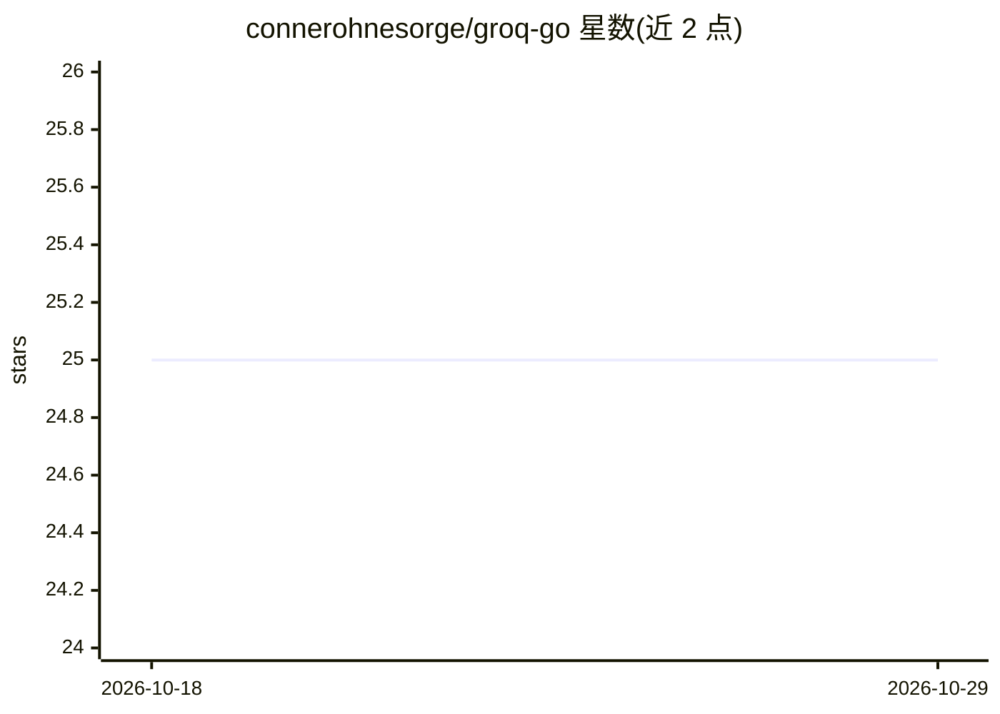

# connerohnesorge/groq-go

⭐ 25 · Go · MIT · 推送 2026-05-04 · [GitHub](https://github.com/connerohnesorge/groq-go) · 个人维护

**Go 语言的 Groq API 非官方客户端库**

以 Go 包形式提供的 Groq API 非官方客户端：以类型安全方式封装 Groq 全部模型的调用，支持聊天补全（含流式与 JSON 对象输出）、内容审核（Moderation）、音频转录与翻译、工具调用与函数调用，并可从 struct 生成 JSON Schema。通过扩展形式支持 Toolhouse、E2B、Composio、Jigsaw Stack 等第三方函数调用集成。面向在 Go 项目中接入 Groq 服务的开发者，通过 go get 安装，使用需提供 Groq API key。

## 筛选速览

| 维度 | 判定 | 备注 |
|---|---|---|
| AI 角色 | `ai-ecosystem` | LLM/agent 周边工具 |
| 许可风险 | `permissive` | MIT |
| 部署形态 | `None` |  |
| 模型依赖 | locked-api |  |
| 硬件要求 | — | 无带数字的原话,不猜 |
| 安装摩擦 | `low` | 无编译、无系统依赖或容器化 |
| 成熟度 | — | 结构信号不足 |

## 能力要点

- 类型安全封装 Groq 全部模型的聊天补全，支持流式输出
- 支持内容审核、音频转录与翻译端点
- 支持 Tool Use、Function Calling 及从 struct 生成 JSON Schema
- Toolhouse / E2B / Composio / Jigsaw Stack 扩展集成

## 适用场景

- 在 Go 应用中调用 Groq 上的开源 LLM 做聊天补全
- 为 Go 项目添加音频转录、翻译或内容审核能力
- 通过 Toolhouse、Composio 等扩展在 agent 中执行函数调用

## 场景标签

 · 领域:LLM 基础设施/API 客户端

## 证据(README 行号)

> L79: Package groq provides a unofficial client for the Groq API.
> L110: - type Client

## 星数曲线

2026-10-18 25 → 2026-10-29 25（+0）

---
*卡片 v1 · prompt 1.4 · 生成 2026-10-27 · 置信度 high · 依据 README sha `a0b0ecbcbc86` · [字段定义](../../DATASET.md)*
