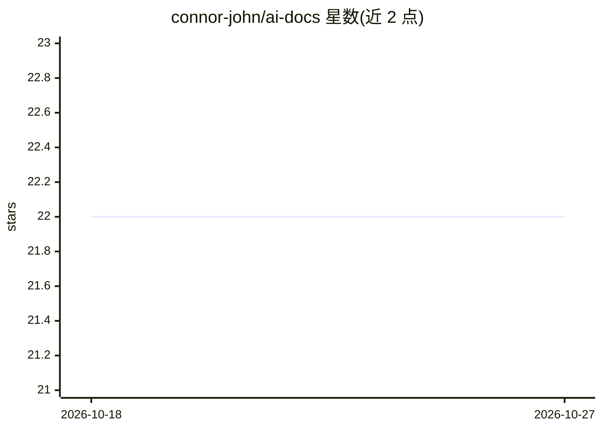

# connor-john/ai-docs

⭐ 22 · Python · 推送 2026-08-30 · [GitHub](https://github.com/connor-john/ai-docs) · 个人维护

**用 Claude 为本地代码仓库自动生成 README 文档的 Python 工具**

面向开发者的文档生成工具：从本地代码仓库提取相关代码文件，过滤无关文件后拼接为文本，通过 anthropic 库调用 Claude 模型生成结构化 README.md（覆盖已有 README）。使用 GPT-2 tokenizer 估算 prompt token 数以避免超出模型上限，需以环境变量 ANTHROPIC_API_KEY 提供 API key。安装依赖 Poetry 与 Python 3.9+，通过 python -m ai_docs.generate_docs 命令运行，限制是仅面向本地仓库且输出为单个 README 文件。

## 筛选速览

| 维度 | 判定 | 备注 |
|---|---|---|
| AI 角色 | `ai-native` | 本体是模型或模型工具 |
| 许可风险 | `none` | — |
| 部署形态 | `None` |  |
| 模型依赖 | locked-api |  |
| 硬件要求 | — | 无带数字的原话,不猜 |
| 安装摩擦 | `low` | 无编译、无系统依赖或容器化 |
| 成熟度 | — | 结构信号不足 |

## 能力要点

- 从本地仓库提取并过滤代码文件后调用 Claude 生成文档
- 用 GPT-2 tokenizer 估算并控制 prompt token 规模
- 以 python -m ai_docs.generate_docs 一条命令生成 README.md

## 适用场景

- 快速为新项目或缺乏文档的仓库生成 README
- 团队交接时快速产出代码库的结构化说明
- 对已有仓库重写/更新文档初稿

## 场景标签

`AI 写作` · 领域:内容生成

## 证据(README 行号)

> L7: AI Docs is a Python project that generates technical documentation for code repositories using the Anthropic Claude 
> L66: 4. The script will extract the relevant code files, send them to the Claude AI model for processing, and generate a

## 星数曲线

2026-10-18 22 → 2026-10-27 22（+0）

---
*卡片 v1 · prompt 1.4 · 生成 2026-10-27 · 置信度 high · 依据 README sha `108566bc62a4` · [字段定义](../../DATASET.md)*
