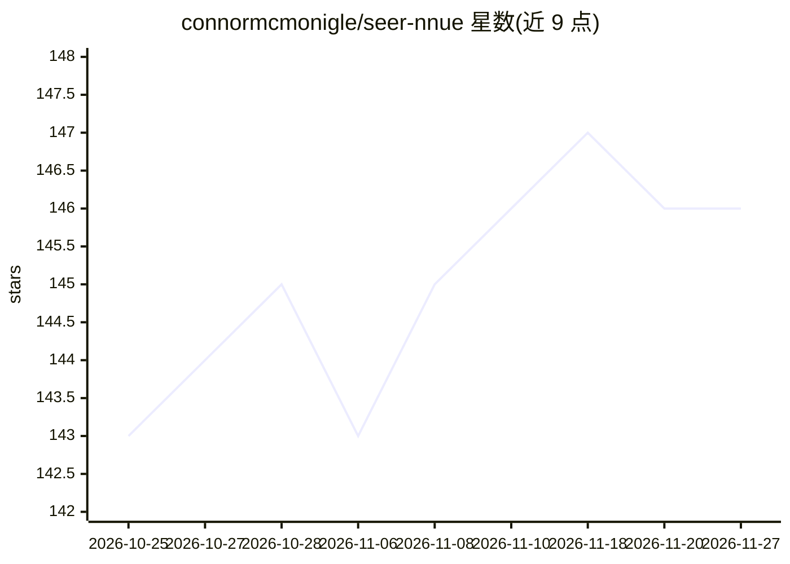

# connormcmonigle/seer-nnue

⭐ 146 · C++ · GPL-3.0 · 推送 2026-11-22 · [GitHub](https://github.com/connormcmonigle/seer-nnue) · 个人维护

**用神经网络做局面评估的国际象棋 UCI 引擎**

Seer 是一个 UCI 协议的国际象棋引擎，用神经网络估算 WDL 概率作为局面评估。训练方式为从 6 子 syzygy 残局库 WDL 值出发，通过逆向学习迭代回传至 32 子局面；搜索采用 alpha-beta 结合 Lazy SMP 多线程与共享置换表。训练脚本使用 PyTorch 做GPU加速；推理端从零实现（OpenMP SIMD 指令与 SIMD intrinsics）。需从源码编译并下载权重文件。

## 筛选速览

| 维度 | 判定 | 备注 |
|---|---|---|
| AI 角色 | `ai-native` | 本体是模型或模型工具 |
| 许可风险 | `viral` | GPL-3.0 |
| 部署形态 | `None` |  |
| 模型依赖 | — | README 未给出锁定关系 |
| 硬件要求 | — | 无带数字的原话,不猜 |
| 安装摩擦 | `low` | 无编译、无系统依赖或容器化 |
| 成熟度 | — | 结构信号不足 |

## 能力要点

- 神经网络局面评估：逆向学习从 6 子残局库回传到 32 子局面
- alpha-beta 搜索 + Lazy SMP 多线程与无锁共享置换表
- 从零实现的网络训练与推理（OpenMP SIMD / SIMD intrinsics）
- 完整剪枝特性集：空着剪枝、LMR、历史启发等

## 适用场景

- 在支持 UCI 的棋类界面中运行对弈
- 自行编译并加载不同权重文件测试引擎强度
- 研究基于残局库数据的逆向网络训练方法

## 场景标签

 · 领域:游戏AI/博弈引擎

## 证据(README 行号)

> L3: Seer is an original, strong UCI chess engine. Seer relies on a neural network estimating WDL probabilities for posit
> L13: - From scratch neural network training and execution (using OpenMP SIMD directives and SIMD intrinsics) implementat

## 星数曲线

2026-10-25 143 → 2026-11-27 146（+3）

---
*卡片 v1 · prompt 1.4 · 生成 2026-11-27 · 置信度 high · 依据 README sha `fb679adf90a1` · [字段定义](../../DATASET.md)*
