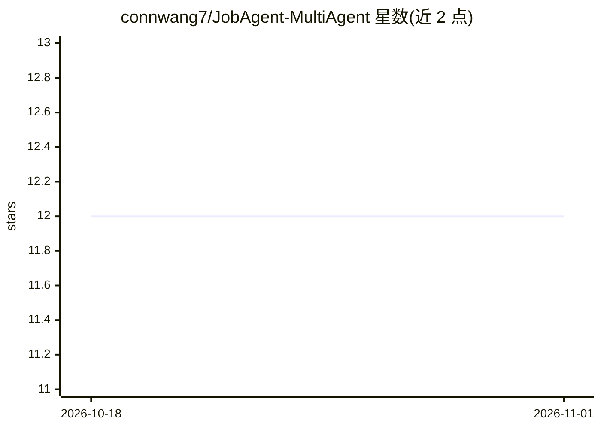

# connwang7/JobAgent-MultiAgent

⭐ 12 · Python · 推送 2026-09-26 · [GitHub](https://github.com/connwang7/JobAgent-MultiAgent) · 个人维护 · 中文 README

**面向求职者的多智能体求职助手：简历分析、岗位搜索、求职信生成**

基于 LangGraph 的多智能体求职助手系统，采用 Supervisor 模式协调简历解析、岗位搜索、求职信生成、公司调研与对话咨询等 Agent。通过 Streamlit 提供 Web 界面，支持上传 PDF 简历、多轮对话与结果下载。模型接入支持通义千问（DashScope 原生及 OpenAI 兼容模式）、OpenAI GPT 与 DeepSeek，通过统一 LLM 抽象层切换；岗位搜索与网页抓取依赖可选的 Serper 与 FireCrawl API Key。安装方式为克隆源码并 pip 安装依赖。

## 筛选速览

| 维度 | 判定 | 备注 |
|---|---|---|
| AI 角色 | `ai-native` | 本体是模型或模型工具 |
| 许可风险 | `none` | — |
| 部署形态 | `library` | 以包/库形式分发 |
| 模型依赖 | — | README 未给出锁定关系 |
| 硬件要求 | — | 无带数字的原话,不猜 |
| 安装摩擦 | `low` | 无编译、无系统依赖或容器化 |
| 成熟度 | — | 结构信号不足 |

## 能力要点

- Supervisor 模式协调 6 个专业 Agent（简历解析/岗位搜索/求职信生成/公司调研等）
- 统一 LLM 抽象层，支持通义千问、OpenAI GPT、DeepSeek 免改码切换
- Streamlit Web 界面，支持 PDF 上传、多轮对话与 DOCX 求职信下载
- 工具层、Agent 层、UI 层解耦的模块化设计

## 适用场景

- 上传简历后让系统分析并推荐匹配岗位
- 根据岗位 JD 和简历生成定制化求职信
- 搜索并调研目标公司的背景信息
- 通过对话获得求职策略建议

## 场景标签

`多智能体` `AI 写作` · 领域:Agent 开发

## 证据(README 行号)

> L5:  基于 LangGraph 的多智能体求职助手系统
> L15: JobAgent-MultiAgent 是一个基于 LangGraph 和多智能体协同架构的智能求职助手系统。通过 Supervisor 模式协调多个专业 Agent，为求职者提供从简历分析、岗位搜索、求职信生成到公司调研的一站式

## 星数曲线

2026-10-18 12 → 2026-11-01 12（+0）

---
*卡片 v1 · prompt 1.4 · 生成 2026-11-01 · 置信度 mid · 依据 README sha `87b4797d3aae` · [字段定义](../../DATASET.md)*
