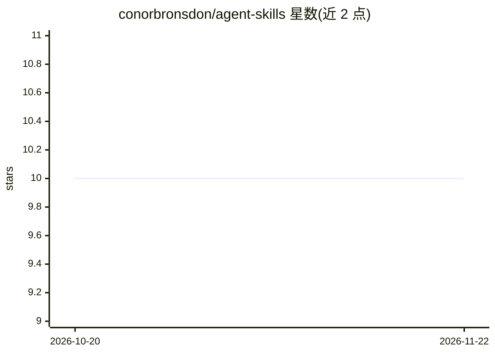

# conorbronsdon/agent-skills

⭐ 10 · Python · MIT · 推送 2026-11-18 · [GitHub](https://github.com/conorbronsdon/agent-skills) · [官网](https://conorbronsdon.com/go/claude-code-skills) · 个人维护

**给编码 agent 安装即用的工作流技能文件集合**

一组以 markdown 文件形式分发的编码 agent 技能：会话管理、多会话状态漂移检测、孤儿 worktree 回收、多 agent 代码评审编排、eval 可信度审计、技能脚手架生成等。通过把技能目录复制到 agent 的 skills 目录即可安装，附带 install.sh 脚本处理安装、更新与漂移检查，支持 Claude Code 默认路径及 Codex/Cursor/OpenCode/generic 目标目录。README 声明项目处于维护模式：仅接收安全修复，不计划新功能。部分技能依赖 GitHub CLI（gh）。

## 筛选速览

| 维度 | 判定 | 备注 |
|---|---|---|
| AI 角色 | `ai-ecosystem` | LLM/agent 周边工具 |
| 许可风险 | `permissive` | MIT |
| 部署形态 | `None` |  |
| 模型依赖 | — | README 未给出锁定关系 |
| 硬件要求 | — | 无带数字的原话,不猜 |
| 安装摩擦 | `low` | 无编译、无系统依赖或容器化 |
| 成熟度 | — | 结构信号不足 |

## 能力要点

- 纯 markdown 技能文件，目录复制即完成安装，会话内热更新
- install.sh 支持 AGENT=claude/codex/cursor/opencode/generic 五种目标目录
- 代码评审编排器按 PR 风险并行生成对抗性与操作性子 agent
- 技能生成器带 frontmatter 规范快照与调用控制参数

## 适用场景

- 让 Claude Code 跨会话记住项目状态与待办
- 高风险 PR 合并前做多 agent 对抗式评审
- 审计 LLM 评测仓库的七项可信度维度
- 清理崩溃会话遗留的孤儿 worktree 与陈旧分支

## 场景标签

`编码 Agent` `代码审查` `模型评测` `多智能体` · 领域:Agent 开发

## 证据(README 行号)

> L5: Production-tested agent skills. Drop-in markdown files that teach a coding agent a specific workflow — Claude Code, 
> L14: These are patterns I built for my own daily work and generalized for anyone to use. They work with Claude Code out 

## 星数曲线

2026-10-20 10 → 2026-11-22 10（+0）

---
*卡片 v1 · prompt 1.4 · 生成 2026-11-19 · 置信度 mid · 依据 README sha `27055fe1083d` · [字段定义](../../DATASET.md)*
