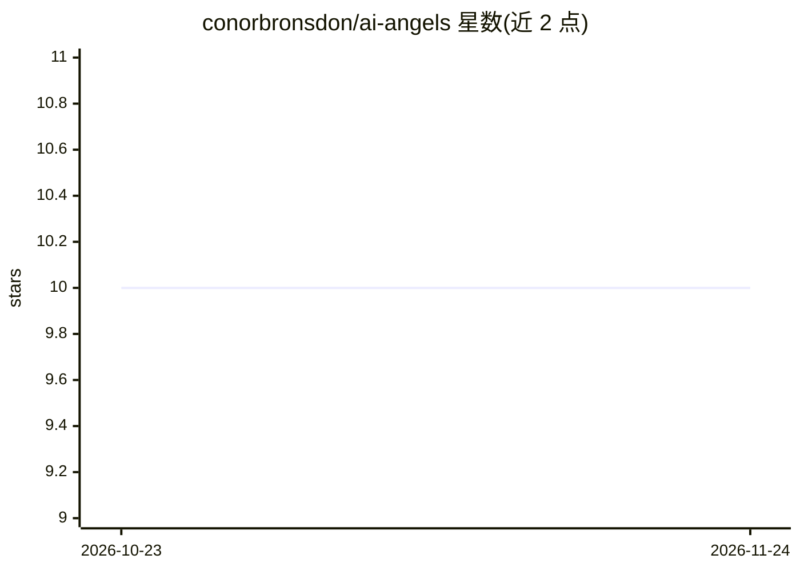

# conorbronsdon/ai-angels

⭐ 10 · JavaScript · CC0-1.0 · 推送 2026-11-18 · [GitHub](https://github.com/conorbronsdon/ai-angels) · [官网](https://conorbronsdon.com/go/ai-angels) · 个人维护

**AI 领域活跃天使投资人清单：51 条带核实日期的编目**

社区维护的 AI 天使投资人名录，收录 51 个条目，每行附核实日期与公开来源链接。收录标准要求：个人出资的天使投资、明确的 AI 方向、近 18 个月内公开投资证据。条目按 AI infra/devtools/applied AI 等方向标注，含支票规模、投资阶段与联系渠道；收录经由 GitHub issue 表单提交、维护者审核，超期条目转入休眠区。数据从 angels.json 再生成，提供交互式目录。

## 筛选速览

| 维度 | 判定 | 备注 |
|---|---|---|
| AI 角色 | `ai-knowledge` | 知识聚合/清单类 |
| 许可风险 | `viral` | CC0-1.0 |
| 部署形态 | `None` |  |
| 模型依赖 | — | README 未给出锁定关系 |
| 硬件要求 | — | 无带数字的原话,不猜 |
| 安装摩擦 | `low` | 无编译、无系统依赖或容器化 |
| 成熟度 | — | 结构信号不足 |

## 能力要点

- 51 个条目均附最后核实日期与公开来源
- 收录标准：个人出资 + AI 方向 + 18 个月内活跃证据
- 条目含支票规模、阶段、联系渠道与代表投资
- 数据存储于 data/angels.json，支持 issue 表单与 PR 两种提交方式

## 适用场景

- 创始人按方向查找正在出票的 AI 天使投资人
- 天使投资人通过表单提交自己的公开信息
- 查阅条目核实日期判断数据新旧

## 场景标签

`精选清单` · 领域:学习与行业

## 证据(README 行号)

> L3: Community-maintained list of active angel investors in AI — verified, dated, PR-editable.
> L14: **51 angels · evidence reviewed on an 18-month cadence · last-verified date + source on every row**
> L101: 2. **AI focus** — infra, devtools, agents, models, or applied AI as a stated or demonstrated focus area.

## 星数曲线

2026-10-23 10 → 2026-11-24 10（+0）

---
*卡片 v1 · prompt 1.4 · 生成 2026-11-19 · 置信度 high · 依据 README sha `44221f812ee5` · [字段定义](../../DATASET.md)*
