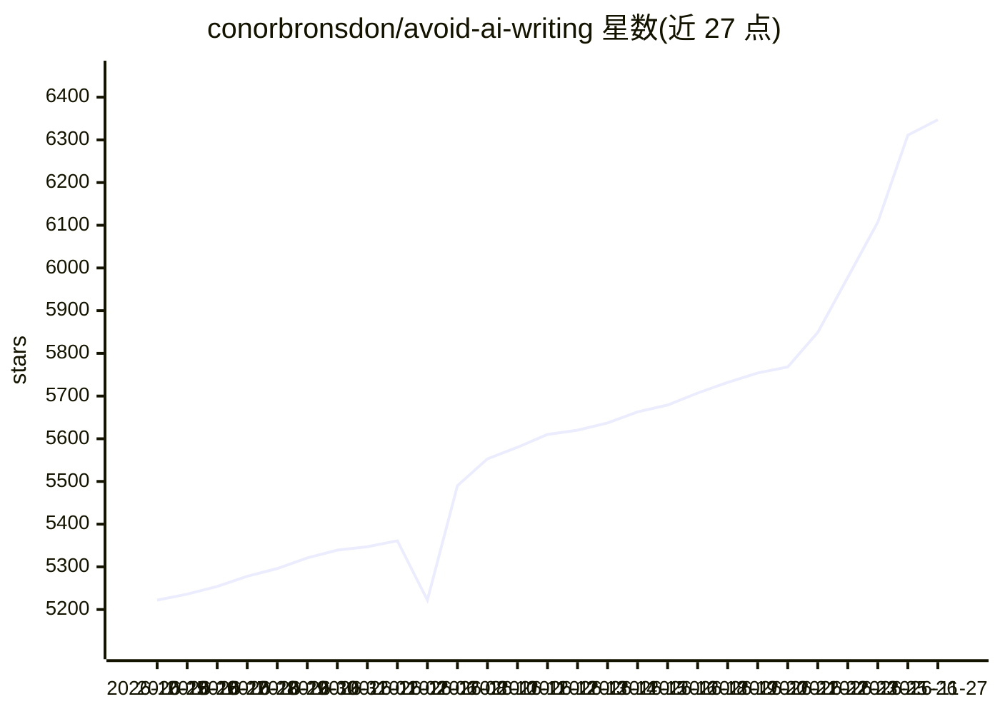

# conorbronsdon/avoid-ai-writing

⭐ 6,347 · JavaScript · MIT · 推送 2026-11-24 · [GitHub](https://github.com/conorbronsdon/avoid-ai-writing) · [官网](https://chainofthought.show/go/avoid-ai-writing/) · 个人维护

**供 AI agent 使用的审计并改写去 AI 腔写作技能**

以 agentskills.io SKILL.md 格式分发的写作技能：审计并改写文本以移除 AI 写作模式。提供 Rewrite（默认，最多两轮编辑并返回单一终稿）、Detect（仅标记不改写）、Edit（原地编辑散文文件）三种模式，附词替换表（112 词条 3 层级）、74 类模式目录与可选的确定性检测器脚本及语音风格档案。规则针对英文校准；以目录克隆或单文件形式安装到 Claude Code、Cowork、Google Antigravity、OpenClaw、Cursor、Hermes、Codex 等目录式 agent。Cursor 移植版不带脚本，审计仅靠模型完成。

## 筛选速览

| 维度 | 判定 | 备注 |
|---|---|---|
| AI 角色 | `ai-native` | 本体是模型或模型工具 |
| 许可风险 | `permissive` | MIT |
| 部署形态 | `library` | 以包/库形式分发 |
| 模型依赖 | — | README 未给出锁定关系 |
| 硬件要求 | — | 无带数字的原话,不猜 |
| 安装摩擦 | `low` | 无编译、无系统依赖或容器化 |
| 成熟度 | — | 结构信号不足 |

## 能力要点

- 三种模式：改写、仅检测、原地编辑（拒绝源代码等结构化内容）
- 112 词条 3 层级替换表与 74 类 AI 写作模式目录（CI 强制计数）
- 自带检测器脚本对 13 类模式打分，支持 --iterate 控制编辑轮数
- 多平台安装路径：Claude Code/Cowork/Antigravity/OpenClaw/Cursor/Hermes/Codex

## 适用场景

- 让编码 agent 把 AI 生成的草稿改得更像人写
- 发布前扫描文档中的 AI 写作痕迹而不改动原文
- 按 casual/professional 等语音档案统一文风

## 场景标签

`提示工程` `编码 Agent` `AI 写作` · 领域:Agent 开发

## 证据(README 行号)

> L3: Audit & rewrite content to remove AI writing patterns. A practical skill for any AI agent. Supports detect-only and 
> L14: A portable writing skill for Claude Code, Codex, OpenClaw, Hermes, and any other agentskills.io-compatible agent. A
> L20: - **Detect** — flags AI patterns without rewriting. Shows which flags are real problems vs. judgment calls. Useful 

## 星数曲线

2026-10-25 5,222 → 2026-11-27 6,347（+1,125）

---
*卡片 v1 · prompt 1.4 · 生成 2026-11-26 · 置信度 mid · 依据 README sha `58796fb51952` · [字段定义](../../DATASET.md)*
