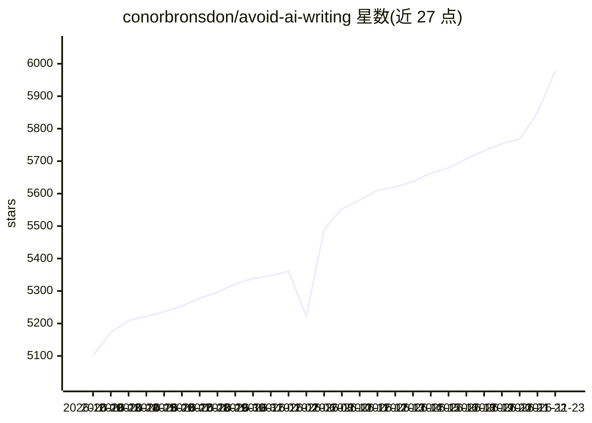

# conorbronsdon/avoid-ai-writing

⭐ 5,978 · JavaScript · MIT · 推送 2026-11-21 · [GitHub](https://github.com/conorbronsdon/avoid-ai-writing) · [官网](https://chainofthought.show/go/avoid-ai-writing/) · 个人维护

**给 AI agent 用的写作技能：检测并改写去除 AI 痕迹**

以 SKILL.md 目录形式分发的写作技能，可在 Claude Code、Codex、OpenClaw、Hermes 等 agentskills.io 兼容 agent 中运行。提供 Rewrite/Detect/Edit 三种模式：默认模式对文本做最多两轮编辑并返回单一最终版本；Detect 仅标记 AI 写作模式；Edit 就地最小化修改散文文件并拒绝结构化内容。内置 13 类检测引擎、112 词替换表（3 层级）与 74 个模式类别的规则目录，附带 voice profile 与迭代上限参数。规则针对英文校准，其他语言依赖社区适配版。

## 筛选速览

| 维度 | 判定 | 备注 |
|---|---|---|
| AI 角色 | `ai-native` | 本体是模型或模型工具 |
| 许可风险 | `permissive` | MIT |
| 部署形态 | `library` | 以包/库形式分发 |
| 模型依赖 | — | README 未给出锁定关系 |
| 硬件要求 | — | 无带数字的原话,不猜 |
| 安装摩擦 | `low` | 无编译、无系统依赖或容器化 |
| 成熟度 | — | 结构信号不足 |

## 能力要点

- Rewrite/Detect/Edit 三模式与 --iterate 编辑轮次上限
- 112 词条替换表（3 层级）与 74 个模式类别的确定性检测引擎
- voice profile 五种语气设定，独立于受众上下文
- 以插件/技能形式适配多个 agent 平台

## 适用场景

- 发布前扫描博客或文档中的 AI 写作痕迹
- 让 agent 就地改写稿件并保留已有的人类段落
- 审阅不希望被改动的内容时只做检测

## 场景标签

`AI 写作` `提示工程` · 领域:Agent 开发

## 证据(README 行号)

> L3: Audit & rewrite content to remove AI writing patterns. A practical skill for any AI agent. Supports detect-only and 
> L14: A portable writing skill for Claude Code, Codex, OpenClaw, Hermes, and any other agentskills.io-compatible agent. A

## 星数曲线

2026-10-20 5,101 → 2026-11-23 5,978（+877）

---
*卡片 v1 · prompt 1.4 · 生成 2026-11-22 · 置信度 mid · 依据 README sha `945886804e5c` · [字段定义](../../DATASET.md)*
