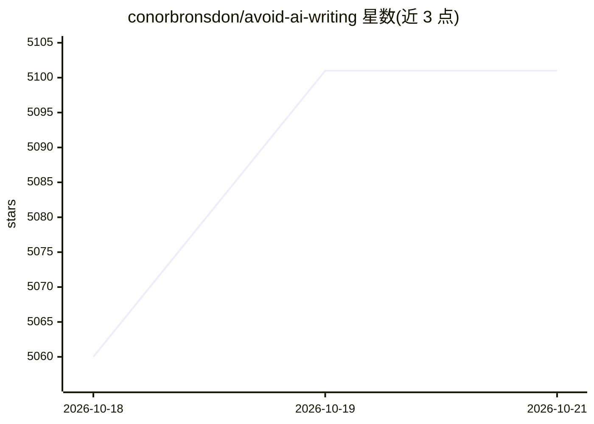

# conorbronsdon/avoid-ai-writing

⭐ 5,173 · JavaScript · MIT · 推送 2026-10-20 · [GitHub](https://github.com/conorbronsdon/avoid-ai-writing) · [官网](https://chainofthought.show/go/avoid-ai-writing/) · 个人维护

**供 AI agent 使用的技能包：检测并改写文中的 AI 写作痕迹**

以 SKILL.md 目录形式分发的写作技能，可装入 Claude Code、Codex、OpenClaw、Cursor、Hermes、Copilot 等 agent 或规则系统。提供 Rewrite/Detect/Edit 三种模式：标记 74 类 AI 写作模式，按 112 词条三档替换表做最多两轮编辑并输出单一终稿；拒绝改写源码与配置文件。可选语气档案（casual/professional 等）与确定性检测器脚本。规则与检测器按英语校准，其他语言为社区独立维护版本。

## 筛选速览

| 维度 | 判定 | 备注 |
|---|---|---|
| AI 角色 | `ai-ecosystem` | LLM/agent 周边工具 |
| 许可风险 | `permissive` | MIT |
| 部署形态 | `library` | 以包/库形式分发 |
| 模型依赖 | — | README 未给出锁定关系 |
| 硬件要求 | — | 无带数字的原话,不猜 |
| 安装摩擦 | `low` | 无编译、无系统依赖或容器化 |
| 成熟度 | — | 结构信号不足 |

## 能力要点

- Rewrite/Detect/Edit 三模式，最多两轮编辑并返回单一终稿
- 74 类模式与 112 词条三档替换表（每词给出具体替换）
- 以目录技能、单文件规则、插件包（含 7 个子技能）多形态分发
- 可选语气档案与捆绑的确定性检测器

## 适用场景

- 写作或发布前清理文本中的 AI 写作痕迹
- 只检测不改写，审计他人内容中的 AI 痕迹
- 在 Claude Code/Codex/Cursor 等工具中作为编辑技能调用

## 场景标签

`AI 写作` `提示工程` · 领域:Agent 开发

## 证据(README 行号)

> L3: Audit & rewrite content to remove AI writing patterns. A practical skill for any AI agent. Supports detect-only and 
> L14: A portable writing skill for Claude Code, Codex, OpenClaw, Hermes, and any other agentskills.io-compatible agent. A
> L53: - **Works across platforms** — a directory-based skill runs in Claude Code, Cowork (as a plugin), OpenClaw, Cursor 

## 星数曲线

2026-10-18 5,060 → 2026-10-21 5,101（+41）

---
*卡片 v1 · prompt 1.4 · 生成 2026-10-20 · 置信度 mid · 依据 README sha `58c2d484a558` · [字段定义](../../DATASET.md)*
