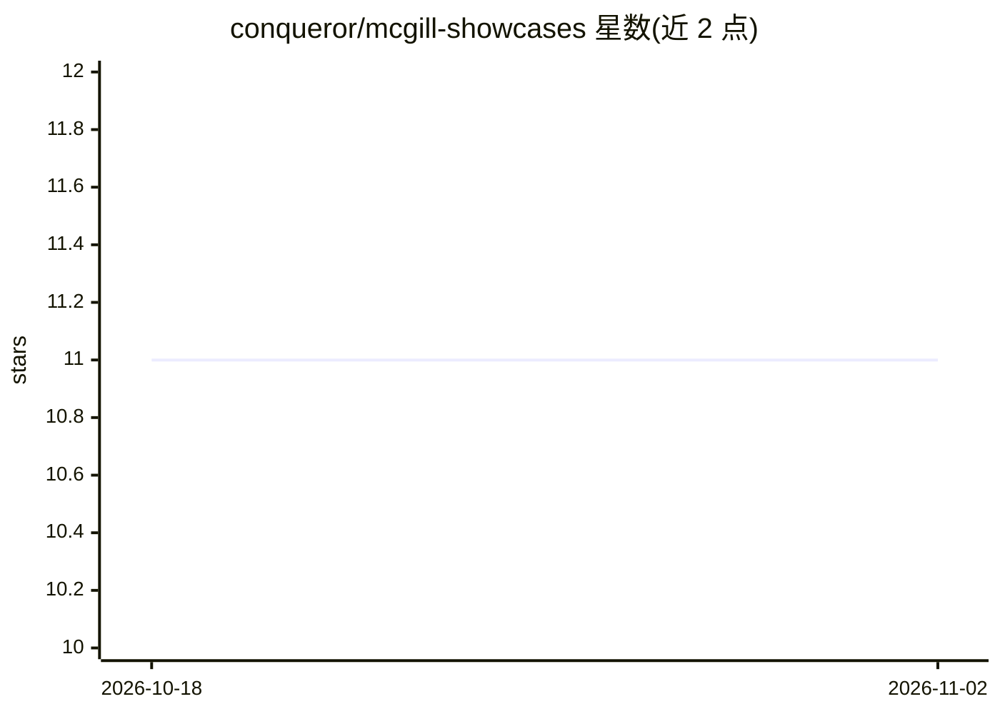

# conqueror/mcgill-showcases

⭐ 11 · Python · MIT · 推送 2026-10-02 · [GitHub](https://github.com/conqueror/mcgill-showcases) · 组织维护

**面向学生的 McGill 机器学习教学项目集（25 个可复现 showcase）**

由 McGill 相关维护的教学型机器学习展示项目合集：收录 25 个自包含 showcase，按深度学习基础、数据基础、监督学习、因果推断与 NLP、Responsible AI、强化学习、Agent 与 Agentic RL、MLOps、API 服务与可观测性等 11 条 track 组织，每个项目标注学习目标、难度、耗时与先修要求，并提供跨 track 学习路径。工具链基于 uv + make，实验日志记录运行时间戳并追加历史；生成产物默认不入 git，由 make run/smoke 在本地复现。文档站基于 MkDocs Material 发布于 GitHub Pages。

## 筛选速览

| 维度 | 判定 | 备注 |
|---|---|---|
| AI 角色 | `ai-knowledge` | 知识聚合/清单类 |
| 许可风险 | `permissive` | MIT |
| 部署形态 | `None` |  |
| 模型依赖 | — | README 未给出锁定关系 |
| 硬件要求 | — | 无带数字的原话,不猜 |
| 安装摩擦 | `low` | 无编译、无系统依赖或容器化 |
| 成熟度 | — | 结构信号不足 |

## 能力要点

- 25 个自包含教学 showcase，按 11 条 track 组织并给出跨 track 学习路径
- uv + make 可复现工具链，实验日志记录时间戳与历史
- 每个项目标注学习目标、难度、耗时与先修要求
- MkDocs Material 文档站与 FastAPI showcase 的本地交互式 API 文档

## 适用场景

- 按学习路径循序渐进掌握从数学基础到生产化部署的 ML 技能
- 挑选特定方向（因果推断、RL、MLOps 等）做动手练习
- 在本地复现实验产物并理解可复现工程实践

## 场景标签

`教程课程` · 领域:学习与行业

## 证据(README 行号)

> L3: Public, student-friendly machine learning showcase projects for learning by doing.
> L28: Twenty-five self-contained showcases, grouped by track and ordered so each builds on the last.
> L48: |`deep-learning-math-foundations-showcase`|Essential math for deep learning: vectors, derivatives, entropy, and gra

## 星数曲线

2026-10-18 11 → 2026-11-02 11（+0）

---
*卡片 v1 · prompt 1.4 · 生成 2026-11-02 · 置信度 high · 依据 README sha `6f434a6c1416` · [字段定义](../../DATASET.md)*
