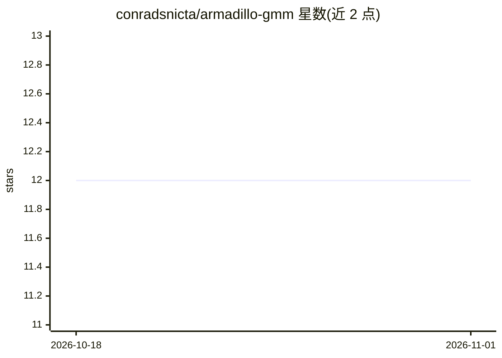

# conradsnicta/armadillo-gmm

⭐ 12 · Apache-2.0 · 推送 2026-09-28 · [GitHub](https://github.com/conradsnicta/armadillo-gmm) · 组织维护

**C++ 多线程高斯混合模型与 EM 训练类库（已并入 Armadillo）**

提供 gmm_diag 与 gmm_full 两个 C++ 类，实现多线程的高斯混合模型（GMM）及配套的 k-means 与期望最大化（EM）训练算法；gmm_diag 面向对角协方差矩阵，gmm_full 面向全协方差矩阵，前者训练与使用速度通常更快但可能损失建模精度。通过将对数域计算、正定协方差约束等手段提升数值稳定性，并以 MapReduce 式重构加 OpenMP 实现多核并行。两类已并入 Armadillo C++ 库的近期版本，文档在 Armadillo 官网维护。

## 筛选速览

| 维度 | 判定 | 备注 |
|---|---|---|
| AI 角色 | `ai-native` | 本体是模型或模型工具 |
| 许可风险 | `permissive` | Apache-2.0 |
| 部署形态 | `None` |  |
| 模型依赖 | — | README 未给出锁定关系 |
| 硬件要求 | — | 无带数字的原话,不猜 |
| 安装摩擦 | `medium` | 含编译或系统依赖之一 |
| 成熟度 | — | 结构信号不足 |

## 能力要点

- 多线程 GMM + k-means + EM 训练实现
- 对角协方差（gmm_diag）与全协方差（gmm_full）两种变体
- 对数域计算与正定约束提升数值稳定性与收敛性
- MapReduce 式重构配合 OpenMP 实现多核加速

## 适用场景

- 在 C++ 项目中做聚类或概率密度建模
- 需要对角/全协方差 GMM 的可并行训练
- 基于 Armadillo 生态集成机器学习组件

## 场景标签

 · 领域:机器学习/科学计算

## 证据(README 行号)

> L9: * The *gmm_diag* and *gmm_full* classes provide multi-threaded (parallelised) implementations of Gaussian mixture mo
> L17: * To achieve multi-threading, the k-means and EM training algorithms have been reformulated into a MapReduce-like f

## 星数曲线

2026-10-18 12 → 2026-11-01 12（+0）

---
*卡片 v1 · prompt 1.4 · 生成 2026-11-01 · 置信度 high · 依据 README sha `a5b75910b8e3` · [字段定义](../../DATASET.md)*
