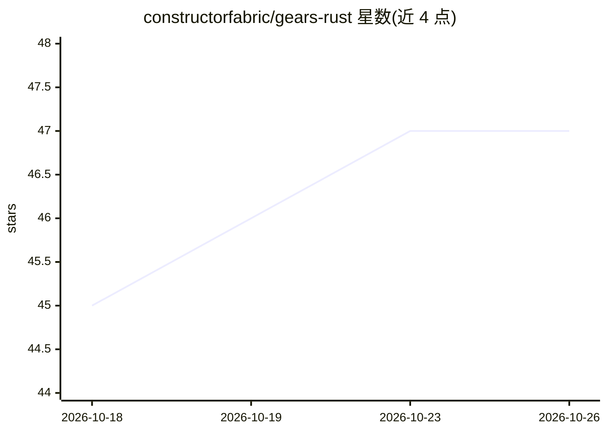

# constructorfabric/gears-rust

⭐ 47 · Rust · Apache-2.0 · 推送 2026-10-25 · [GitHub](https://github.com/constructorfabric/gears-rust) · [官网](https://www.constructorfabric.org) · 组织维护

**Rust 编写的模块化 XaaS 框架与中间件，面向多租户服务构建**

由 Constructor Fabric Foundation 开发的 Rust 框架，提供可组合的库（gears）供 XaaS 厂商组装自有产品：Core 层（API 网关、认证授权、账户管理、多租户）、Serverless 层（函数、工作流、事件驱动）、GenAI 层（聊天、检索、提示编排）。安全采用纵深防御：编译期租户隔离、PDP/PEP 授权、架构级 lint。厂商自选部署形态（单进程边缘、裸机多节点或 Kubernetes）。需自备 MariaDB/PostgreSQL/SQLite 数据库，通过 make/cargo 构建运行示例服务器，非开箱即用服务。

## 筛选速览

| 维度 | 判定 | 备注 |
|---|---|---|
| AI 角色 | `ai-ecosystem` | LLM/agent 周边工具 |
| 许可风险 | `permissive` | Apache-2.0 |
| 部署形态 | `library` | 以包/库形式分发 |
| 模型依赖 | — | README 未给出锁定关系 |
| 硬件要求 | — | 无带数字的原话,不猜 |
| 安装摩擦 | `low` | 无编译、无系统依赖或容器化 |
| 成熟度 | — | 结构信号不足 |

## 能力要点

- 三层 gear 体系：Toolkit、System gears、Service gears
- 每个 API 处理器默认强制认证、授权、租户隔离与数据库作用域
- GenAI gears 覆盖聊天、检索与提示编排
- FIPS 140-3 特性将 TLS 加密路由至各平台 CMVP 验证模块

## 适用场景

- XaaS 厂商组装带多租户与配额管理的企业级服务
- 构建从边缘设备到 Kubernetes 的可组合后端
- 在统一框架内集成 API 网关、认证与事件系统

## 场景标签

`工作流自动化` · 领域:效率与自动化

## 证据(README 行号)

> L6: **Gears** is a secure, modular XaaS framework and middleware, developed in Rust by the Constructor Fabric Foundation
> L13: - **GenAI** gears for chat, retrieval, prompt orchestration, and related AI capabilities.

## 星数曲线

2026-10-18 45 → 2026-10-26 47（+2）

---
*卡片 v1 · prompt 1.4 · 生成 2026-10-25 · 置信度 mid · 依据 README sha `c90f2824522e` · [字段定义](../../DATASET.md)*
