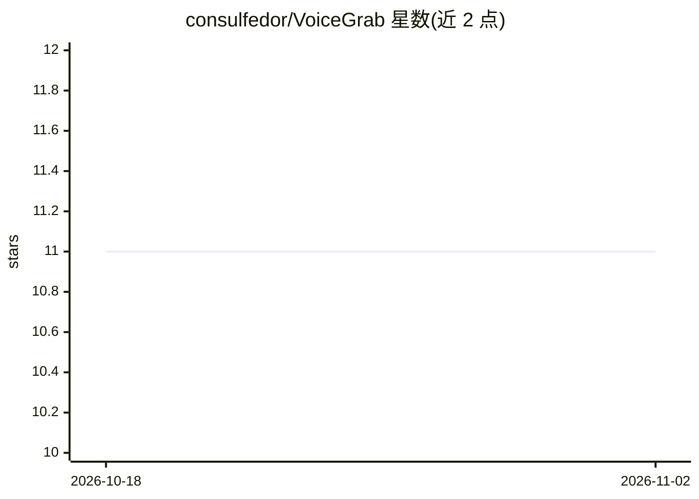

# consulfedor/VoiceGrab

⭐ 11 · PowerShell · MIT · 推送 2026-01-06 · [GitHub](https://github.com/consulfedor/VoiceGrab) · 个人维护

**Windows 语音转文字工具：录音→Groq Whisper 转写→粘贴到任意应用**

面向 Windows 用户的系统级语音输入工具：按 Right Ctrl 录音，经 Groq Whisper API 转写（57 种语言），文本自动粘贴到当前活动窗口，适用于 VS Code、Slack、Word 等任意应用。提供填充词清理与 Whisper 幻觉短语过滤，支持 Groq/DeepL 两种翻译引擎（如俄语说出→英文输出）。含 5 种可定制模式（AI 聊天/代码/文档/笔记/闲聊），各模式可独立设置语言、提示词与翻译策略。需联网使用，云端处理后音频即删；通过下载 Release ZIP 或克隆源码安装，依赖 Python 3.10+。Gemini 集成为实验性开发中功能。

## 筛选速览

| 维度 | 判定 | 备注 |
|---|---|---|
| AI 角色 | `ai-native` | 本体是模型或模型工具 |
| 许可风险 | `permissive` | MIT |
| 部署形态 | `None` |  |
| 模型依赖 | locked-api |  |
| 硬件要求 | — | 无带数字的原话,不猜 |
| 安装摩擦 | `low` | 无编译、无系统依赖或容器化 |
| 成熟度 | `idea` | |

## 能力要点

- Groq Whisper API 转写，支持 57 种语言，免费额度约每日 8 小时听写
- 系统级自动粘贴到任意 Windows 应用（非浏览器扩展）
- 填充词清理与 Whisper 幻觉短语过滤
- Groq/DeepL 双翻译引擎，Off/Replace/Append 三种模式

## 适用场景

- 在 ChatGPT、Copilot 等 AI 工具中用语音代替打字输入提示词
- 跨语言听写：俄语说出自动翻译为英文粘贴到 Word
- 写代码或文档时按一个键语音输入并自动清理口语杂词

## 场景标签

`语音识别` · 领域:感知与多模态

## 证据(README 行号)

> L19: VoiceGrab is a **free, open-source alternative** to Dragon NaturallySpeaking ($300) and Windows Voice Typing. Uses 
> L76: - ⚡ **Groq Whisper API** — Fast, accurate, FREE tier

## 星数曲线

2026-10-18 11 → 2026-11-02 11（+0）

---
*卡片 v1 · prompt 1.4 · 生成 2026-11-02 · 置信度 high · 依据 README sha `4e6bad37f191` · [字段定义](../../DATASET.md)*
