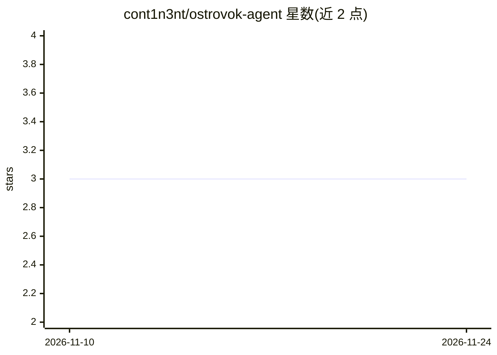

# cont1n3nt/ostrovok-agent

⭐ 3 · Python · 推送 2026-10-29 · [GitHub](https://github.com/cont1n3nt/ostrovok-agent) · [官网](ostrovok.kosmoweb.ru) · 组织维护

**一次消息生成整套旅行方案的 AI 旅行规划 Agent**

黑客松产出的旅行规划 Agent：从一条自然语言消息解析日期与隐含需求，组装 2–3 套含交通、接驳与酒店的完整行程，给出总价与差异说明，并支持改期、加购与下单。关键机制是金额计算与行程校验由代码完成，模型只负责解释，另设有联系性检查（如航班晚于入住、家庭住青旅）拦截。数据为演示模型：酒店来自 OpenStreetMap 的索契数据，机票为 Aviasales 缓存价格；单实例单位置，存储用 SQLite。

## 筛选速览

| 维度 | 判定 | 备注 |
|---|---|---|
| AI 角色 | `ai-native` | 本体是模型或模型工具 |
| 许可风险 | `none` | — |
| 部署形态 | `self-host` | docker 或自建部署 |
| 模型依赖 | — | README 未给出锁定关系 |
| 硬件要求 | — | 无带数字的原话,不猜 |
| 安装摩擦 | `low` | 无编译、无系统依赖或容器化 |
| 成熟度 | — | 结构信号不足 |

## 能力要点

- 一次消息输出 2–3 套含总价与卢布差额的完整行程
- 金额与联系性校验由代码执行，模型仅解释
- 任何支持工具调用的 OpenAI 兼容模型均可通过环境变量替换
- LangSmith 追踪与 24 个场景的 evals 评估流程

## 适用场景

- 为家庭出行快速生成带交通与酒店的整包方案
- 对话式改期、换 cheaper 方案并看到差额
- 在 Ostrovok 风格业务中接入预订流程原型

## 场景标签

 · 领域:旅行/生活服务

## 证据(README 行号)

> L1: # Pulse — ИИ-агент, который собирает поездку целиком (трек Островок «О!дин запрос»)
> L8: Главная идея: **суммы и состыковки считает код, а модель только объясняет.** Поэтому итог всегда
> L100: Провайдер — smartapi.pro (OpenAI-совместимый API), модель — **`claude-haiku-5-5`**.

## 星数曲线

2026-11-10 3 → 2026-11-24 3（+0）

---
*卡片 v1 · prompt 1.4 · 生成 2026-11-22 · 置信度 high · 依据 README sha `00a4a86e8f98` · [字段定义](../../DATASET.md)*
