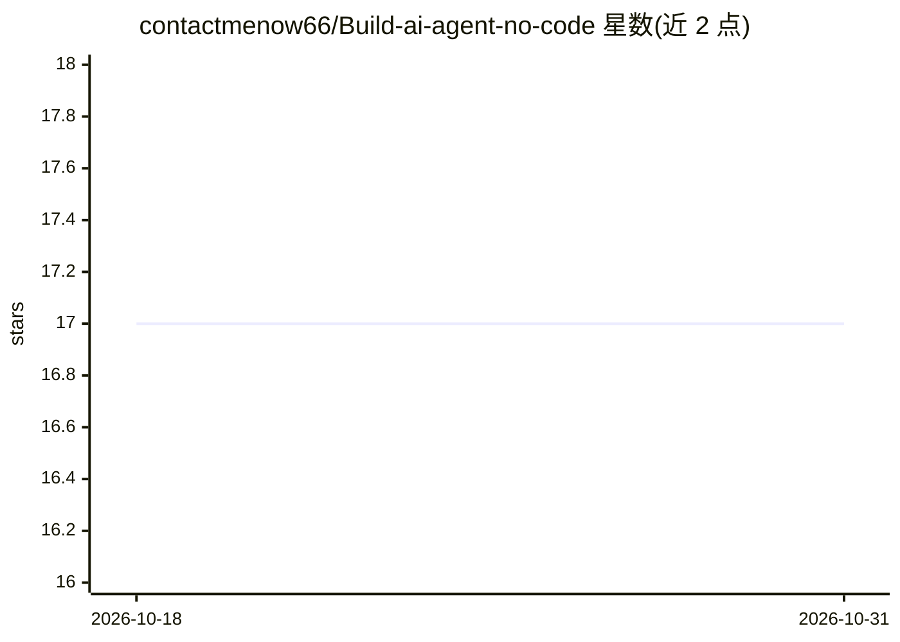

# contactmenow66/Build-ai-agent-no-code

⭐ 17 · 推送 2026-09-15 · [GitHub](https://github.com/contactmenow66/Build-ai-agent-no-code) · 个人维护

**无代码搭建 AI 客服 agent 的分步教程（基于 Agent X）**

面向电商、SaaS 与中小企业运营者的图文教程：介绍如何用 Agent X 平台在约 5 分钟内零代码创建、配置并嵌入 RAG 驱动的 AI 客服 agent。流程为四步：控制台创建 agent 并选择 LLM 引擎、上传文档或粘贴网站 URL 构建知识库、编写角色提示词、复制单行 script 嵌入网站；支持 Slack/Discord 接入与 Webhook 触发。本仓库为指南文档，不含可运行代码，agent 的构建与运行依赖 Agent X 托管服务。

## 筛选速览

| 维度 | 判定 | 备注 |
|---|---|---|
| AI 角色 | `ai-knowledge` | 知识聚合/清单类 |
| 许可风险 | `none` | — |
| 部署形态 | `None` |  |
| 模型依赖 | — | README 未给出锁定关系 |
| 硬件要求 | — | 无带数字的原话,不猜 |
| 安装摩擦 | `low` | 无编译、无系统依赖或容器化 |
| 成熟度 | — | 结构信号不足 |

## 能力要点

- 四步零代码流程：创建 agent→导入知识库→设定提示词→嵌入网站
- RAG 知识库支持文档上传与网站 URL 自动抓取
- 单行 script 嵌入，支持 Slack/Discord 与 Webhook

## 适用场景

- 我想给网店加一个基于自有文档的自动客服
- 夜间与周末无人值守时自动接待咨询并收集线索
- 把重复的常见问题交给 AI 回答，减轻团队负担

## 场景标签

`教程课程` `聊天机器人` · 领域:对话与助手

## 证据(README 行号)

> L1: # How to Build a No-Code AI Customer Support Agent? Achieve 24/7 Automated Response with Agent X
> L13: With **Agent X**, you can build and embed an intelligent, 24/7 AI customer support agent into your website or app i

## 星数曲线

2026-10-18 17 → 2026-10-31 17（+0）

---
*卡片 v1 · prompt 1.4 · 生成 2026-10-29 · 置信度 mid · 依据 README sha `8e1c5b75d882` · [字段定义](../../DATASET.md)*
