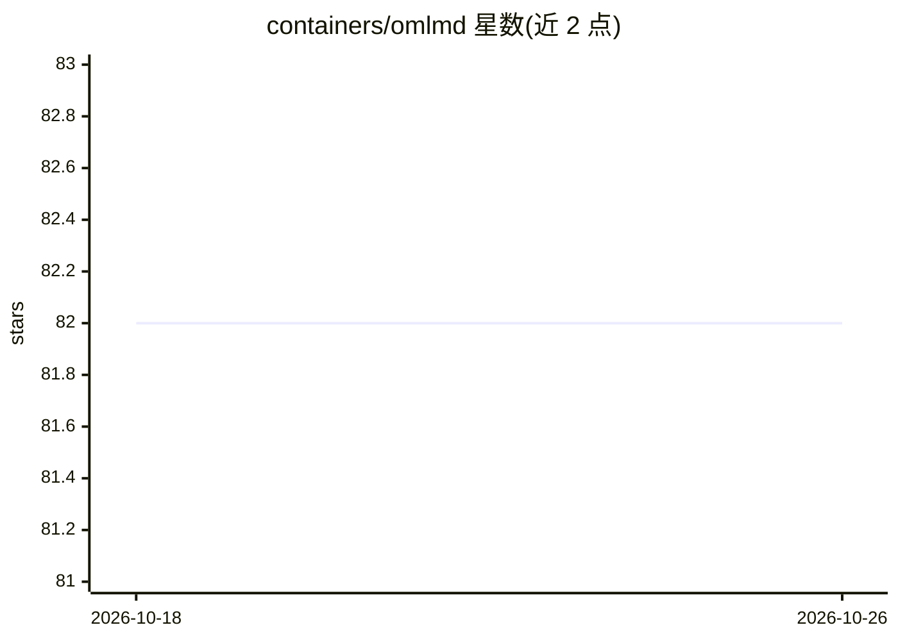

# containers/omlmd

⭐ 82 · Python · Apache-2.0 · 推送 2026-04-27 · [GitHub](https://github.com/containers/omlmd) · [官网](https://containers.github.io/omlmd) · 组织维护

**以 OCI Artifact 打包/分发 ML 模型与元数据的 SDK 和 CLI**

containers 组织下的开源工具链：提供 Python SDK 与 CLI，将 ML 模型文件与元数据按 OCI Artifact 规范打包，push 到 OCI 兼容仓库，可整体 pull、仅拉取模型资产或仅读取元数据；支持对多个制品的元数据进行客户端爬取，并可与 jQ 结合查询（如按 accuracy 选最优模型）。面向需要在容器/OCI 生态中存储和分发模型的开发者，以 pip 安装，附文档、教程与视频播放列表。

## 筛选速览

| 维度 | 判定 | 备注 |
|---|---|---|
| AI 角色 | `ai-ecosystem` | LLM/agent 周边工具 |
| 许可风险 | `permissive` | Apache-2.0 |
| 部署形态 | `library` | 以包/库形式分发 |
| 模型依赖 | — | README 未给出锁定关系 |
| 硬件要求 | — | 无带数字的原话,不猜 |
| 安装摩擦 | `low` | 无编译、无系统依赖或容器化 |
| 成熟度 | — | 结构信号不足 |

## 能力要点

- Python Helper 一行 push/pull 模型与元数据到 OCI 仓库
- 支持按 media_types 只拉取模型资产、只读取元数据
- 客户端 crawl 多制品元数据并用 jQ 查询（如取 accuracy 最高者）

## 适用场景

- 把训练好的模型和元数据作为 OCI 制品存入镜像仓库
- 跨版本比较模型元数据并选出精度最高的制品
- 在 OCI/容器化流水线中分发 ML 模型

## 场景标签

 · 领域:MLOps/模型分发

## 证据(README 行号)

> L13: This project is a collection of blueprints, patterns and toolchain (in the form of python SDK and CLI) to leverage 
> L34: Store ML model file `model.joblib` and its metadata in the OCI repository at `localhost:8080`:

## 星数曲线

2026-10-18 82 → 2026-10-26 82（+0）

---
*卡片 v1 · prompt 1.4 · 生成 2026-10-24 · 置信度 high · 依据 README sha `ff3fa16bc862` · [字段定义](../../DATASET.md)*
