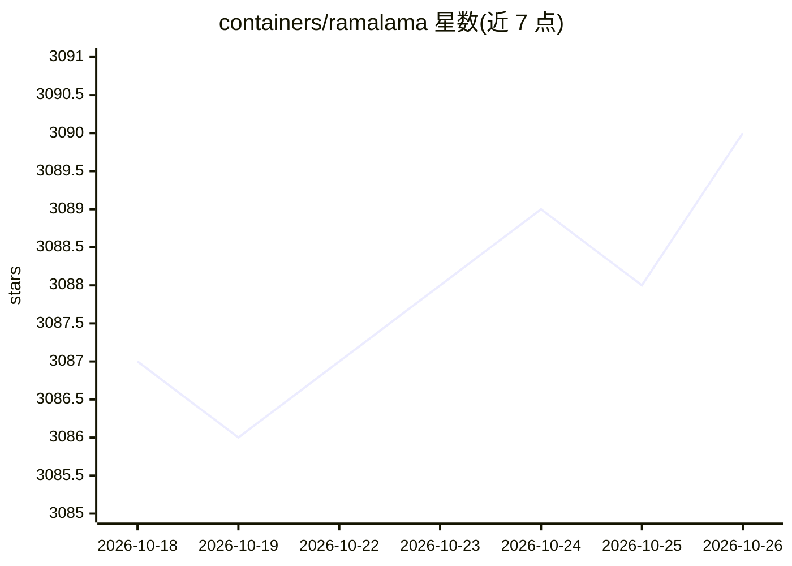

# containers/ramalama

⭐ 3,090 · Python · MIT · 推送 2026-10-24 · [GitHub](https://github.com/containers/ramalama) · [官网](https://ramalama.ai) · 组织维护

**用容器方式本地运行与对外服务 AI 模型的命令行工具**

RamaLama 通过 OCI 容器封装 AI 模型的本地使用与推理服务：首次运行时探测主机 GPU，自动拉取对应的加速容器镜像（CUDA/ROCm/Asahi/Intel/Moore Threads 等），免去主机侧配置。模型按类似容器镜像的方式管理（pull/run/serve），支持 HuggingFace、ModelScope、Ollama、OCI Registry 等多种模型来源，可启动聊天或 REST API 服务。默认以 rootless 容器、无网络访问、退出即清理的方式运行模型进程（llama.cpp 或 vLLM）。提供 pip、dnf、macOS pkg 安装包与安装脚本。

## 筛选速览

| 维度 | 判定 | 备注 |
|---|---|---|
| AI 角色 | `ai-ecosystem` | LLM/agent 周边工具 |
| 许可风险 | `permissive` | MIT |
| 部署形态 | `desktop` | 安装包/桌面程序 |
| 模型依赖 | local-ok | 支持本地模型 |
| 硬件要求 | — | 无带数字的原话,不猜 |
| 安装摩擦 | `medium` | 含编译或系统依赖之一 |
| 成熟度 | — | 结构信号不足 |

## 能力要点

- 按主机 GPU 自动选择并拉取加速容器镜像（CPU/CUDA/ROCm/Asahi/Intel/MUSA/CANN）
- 以容器命令风格管理模型，支持 pull/run/serve 与 REST API/聊天交互
- 默认 rootless 容器 + 无网络 + 只读挂载 + 退出清理的安全运行方式
- 支持 HuggingFace、ModelScope、Ollama、OCI Registry 等模型来源，macOS 可用 MLX 运行时

## 适用场景

- 在容器环境（Podman/Docker）中一键拉取并运行本地大模型
- 为生产推理提供基于容器的本地模型服务（REST API）
- 在隔离且无网络访问的环境中安全测试不可信模型文件
- 在多 GPU 硬件（NVIDIA/AMD/Intel/摩尔线程等）上免手动配置运行模型

## 场景标签

`推理引擎` · 领域:训练与推理

## 证据(README 行号)

> L25: RamaLama is an open-source tool that simplifies the local use and serving of AI models for inference from any sourc
> L143: RamaLama then pulls AI Models from model registries, starting a chatbot or REST API service from a simple single c

## 星数曲线

2026-10-18 3,087 → 2026-10-26 3,090（+3）

---
*卡片 v1 · prompt 1.4 · 生成 2026-10-20 · 置信度 high · 依据 README sha `88625a45f5ee` · [字段定义](../../DATASET.md)*
