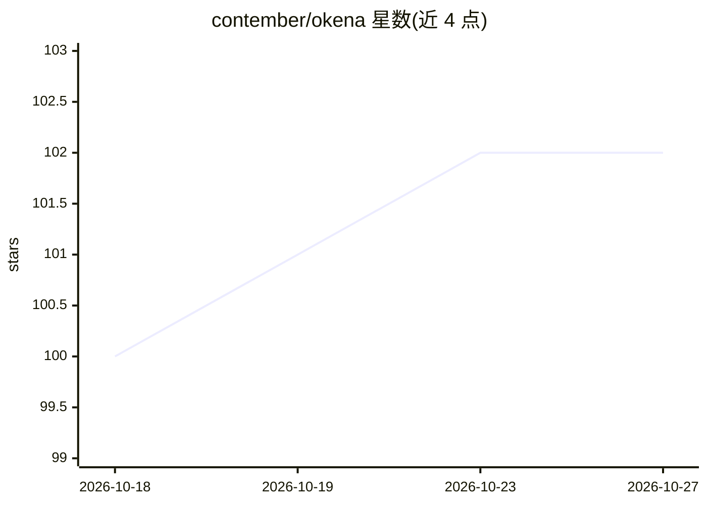

# contember/okena

⭐ 102 · Rust · MIT · 推送 2026-10-26 · [GitHub](https://github.com/contember/okena) · [官网](https://www.okena.dev) · 组织维护

**Rust 原生终端复用器，带 AI 工具状态与用量集成**

基于 Rust 与 GPUI（Zed 编辑器的 UI 框架）构建的原生终端复用器，提供分屏、标签页、可脱离窗口、命令面板与工作区自动恢复。支持 dtach/tmux/screen 会话持久化、git worktree 管理、okena.yaml 项目服务与 Docker Compose 集成、远程 HTTP/WebSocket 控制 API 及 React Native 移动端。AI 相关部分为可选启用的 Claude Code 实时状态与用量跟踪、OpenAI Codex 状态监控，及面向 Claude Code 的图片粘贴与 Shift+Enter 多行输入。三平台提供安装脚本，macOS/Linux/Windows 均支持。

## 筛选速览

| 维度 | 判定 | 备注 |
|---|---|---|
| AI 角色 | `ai-enhanced` | 去掉 AI 部分产品仍成立 |
| 许可风险 | `permissive` | MIT |
| 部署形态 | `self-host` | docker 或自建部署 |
| 模型依赖 | locked-api |  |
| 硬件要求 | — | 无带数字的原话,不猜 |
| 安装摩擦 | `low` | 无编译、无系统依赖或容器化 |
| 成熟度 | — | 结构信号不足 |

## 能力要点

- 分屏/标签/可脱离窗口与命令面板
- dtach/tmux/screen 会话持久化（含 WSL）
- 可选启用的 Claude Code 状态与用量跟踪、Codex 状态监控
- 远程控制 API 与 React Native 移动端伴侣应用

## 适用场景

- 多项目多终端的日常工作区管理
- 在终端中配合 Claude Code 等 AI 工具并跟踪其用量
- 通过手机或浏览器远程操作本地终端

## 场景标签

 · 领域:开发者工具/终端

## 证据(README 行号)

> L5: A fast, native terminal multiplexer built in Rust with GPUI (the UI framework from Zed editor).
> L112: ### AI Tool Integration

## 星数曲线

2026-10-18 100 → 2026-10-27 102（+2）

---
*卡片 v1 · prompt 1.4 · 生成 2026-10-23 · 置信度 mid · 依据 README sha `2302fe91f6f0` · [字段定义](../../DATASET.md)*
