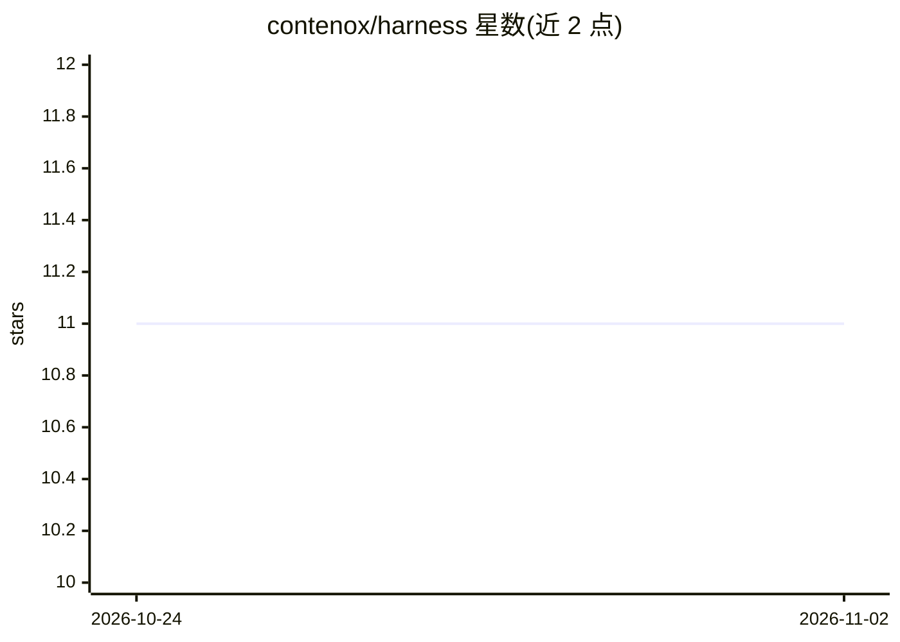

# contenox/harness

⭐ 11 · TypeScript · Apache-2.0 · 推送 2026-11-01 · [GitHub](https://github.com/contenox/harness) · [官网](https://contenox.com) · 组织维护

**策略约束、厂商中立的 AI agent 编排桌面运行时**

开源桌面应用加捆绑运行时：以本地进程执行操作者编写的 agent 工作流（Chains），每次工具调用前按操作者编写的策略文件把关，破坏性操作需 human-in-the-loop 审批，会话与记录保存在本地磁盘。后端（OpenAI、Ollama、vLLM、DeepSeek 等）为配置项，chat 与 completion 可分别路由不同模型；运行时提供 CLI、HTTP API 与 ACP，Zed/JetBrains 等编辑器经 ACP 接入。面向生产仓库、内部 API、发布流水线等高后果工程环境。

## 筛选速览

| 维度 | 判定 | 备注 |
|---|---|---|
| AI 角色 | `ai-ecosystem` | LLM/agent 周边工具 |
| 许可风险 | `permissive` | Apache-2.0 |
| 部署形态 | `desktop` | 安装包/桌面程序 |
| 模型依赖 | local-ok | 支持本地模型 |
| 硬件要求 | — | 无带数字的原话,不猜 |
| 安装摩擦 | `low` | 无编译、无系统依赖或容器化 |
| 成熟度 | — | 结构信号不足 |

## 能力要点

- 策略文件在工具调用前由 harness 强制执行
- chat 与 completion 角色分离，可混合云端与本地模型路由
- 经 ACP 接入 Zed/JetBrains 等编辑器，同一 Chain 跨终端运行
- 支持 MCP 服务器与 OpenAPI 子集封装为受控工具

## 适用场景

- 在受控边界内让 AI agent 审查 diff、跑测试并生成变更日志
- 把内部 API 封装为带授权限制的安全工具供 agent 调用
- 跨终端/IDE/headless 脚本统一执行带审批门的工作流

## 场景标签

`Agent 框架` · 领域:Agent 开发

## 证据(README 行号)

> L7: Contenox runs authored agent workflows as a local process. The policy that gates
> L108: |**LangChain / Frameworks**|Software development libraries are not end-user products. Contenox provides an out-of-

## 星数曲线

2026-10-24 11 → 2026-11-02 11（+0）

---
*卡片 v1 · prompt 1.4 · 生成 2026-11-02 · 置信度 mid · 依据 README sha `bdacfa3af01f` · [字段定义](../../DATASET.md)*
