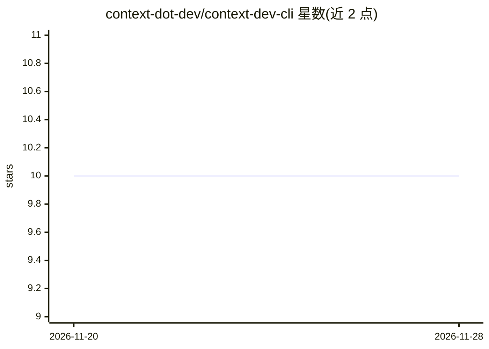

# context-dot-dev/context-dev-cli

⭐ 10 · Go · Apache-2.0 · 推送 2026-11-27 · [GitHub](https://github.com/context-dot-dev/context-dev-cli) · [官网](https://context.dev) · 组织维护

**为开发者提供终端内网页抓取/搜索并输出 LLM 就绪数据的 CLI**

Context Dev REST API 的官方命令行客户端，由 Stainless 生成。终端内提供网页抓取、爬取、搜索与截图能力，返回 markdown 或 JSON 格式、面向 LLM 输入的数据。需 Context Dev API key（环境变量或 --api-key 传入），支持多种输出格式（json/jsonl/yaml 等）、GJSON 输出转换、@文件传参（含文本/二进制编码选择）。通过 Go 安装或克隆仓库后以脚本运行。

## 筛选速览

| 维度 | 判定 | 备注 |
|---|---|---|
| AI 角色 | `ai-ecosystem` | LLM/agent 周边工具 |
| 许可风险 | `permissive` | Apache-2.0 |
| 部署形态 | `library` | 以包/库形式分发 |
| 模型依赖 | — | README 未给出锁定关系 |
| 硬件要求 | — | 无带数字的原话,不猜 |
| 安装摩擦 | `low` | 无编译、无系统依赖或容器化 |
| 成熟度 | — | 结构信号不足 |

## 能力要点

- 抓取/爬取/搜索/截图结果以 markdown 或 JSON 输出，面向 LLM 就绪格式
- 支持 auto/json/jsonl/pretty/raw/yaml 等输出格式与 GJSON 转换
- @file 传参支持文件类型嗅探与显式 base64/文本编码
- 支持 --base-url 自定义 API 后端与 --debug 调试日志

## 适用场景

- 为 RAG 或 agent 流水线从终端获取网页的 markdown/JSON 数据
- 在命令行中抓取、爬取、搜索网页并截图
- 通过 API key 与可配置后端接入 Context Dev 服务

## 场景标签

`网页抓取` · 领域:效率与自动化

## 证据(README 行号)

> L3: The official CLI for the Context Dev REST API.
> L14: go install 'github.com/context-dot-dev/context-dev-cli/cmd/context-dev@latest'

## 星数曲线

2026-11-20 10 → 2026-11-28 10（+0）

---
*卡片 v1 · prompt 1.4 · 生成 2026-11-20 · 置信度 high · 依据 README sha `d1cbe153e737` · [字段定义](../../DATASET.md)*
