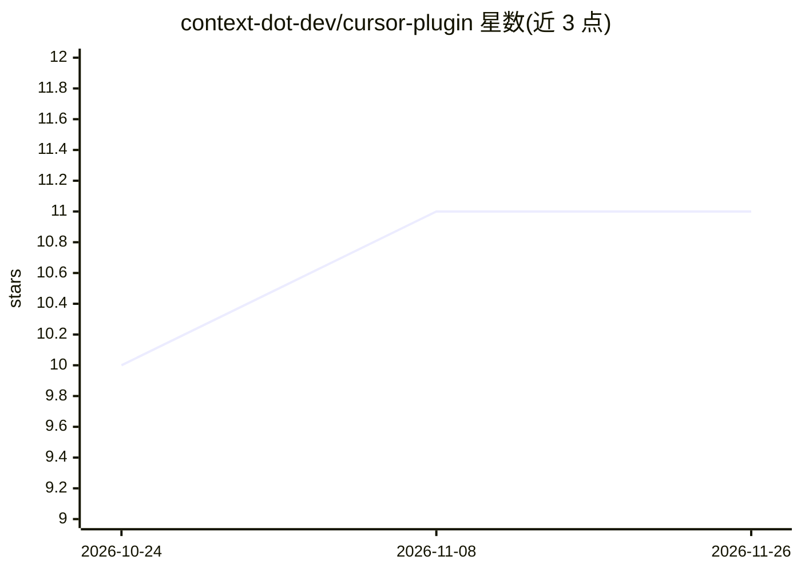

# context-dot-dev/cursor-plugin

⭐ 11 · JavaScript · MIT · 推送 2026-11-12 · [GitHub](https://github.com/context-dot-dev/cursor-plugin) · [官网](https://context.dev) · 组织维护

**给 Cursor 接入实时网页搜索、抓取与结构化提取的 MCP 插件**

Context.dev 的官方 Cursor 插件，通过 MCP 服务器以 OAuth 连接生产环境端点，为 Cursor 提供 42 个类型化工具，覆盖网页搜索、抓取、多页爬取、按 schema 提取 JSON、文档解析（PDF/Office/图片）、品牌信息检索、截图、定期变更监控与最多 25,000 URL 的异步批量任务。随插件附带 11 个技能、4 个命令与规则，用于把网页类任务路由到对应工具。需在 Cursor Marketplace 安装并登录 Context.dev 账号授权。

## 筛选速览

| 维度 | 判定 | 备注 |
|---|---|---|
| AI 角色 | `ai-ecosystem` | LLM/agent 周边工具 |
| 许可风险 | `permissive` | MIT |
| 部署形态 | `None` |  |
| 模型依赖 | — | README 未给出锁定关系 |
| 硬件要求 | — | 无带数字的原话,不猜 |
| 安装摩擦 | `low` | 无编译、无系统依赖或容器化 |
| 成熟度 | — | 结构信号不足 |

## 能力要点

- 42 个直接、类型化的 MCP 工具与 OAuth 连接
- 11 个技能与 /search-web、/scrape-url 等命令
- submit-batch 支持最多 25,000 URL 的异步批量抓取
- 定期网站变更监控与 webhook 交付管理

## 适用场景

- 在 Cursor 中让 AI 搜索实时网页并引用来源 URL
- 抓取指定网页并转为 Markdown 或结构化 JSON
- 解析 PDF、Office 等本地文档供模型使用
- 定期监控网站变更并接收通知

## 场景标签

`网页抓取` `文档解析` · 领域:效率与自动化

## 证据(README 行号)

> L3: The official Context.dev plugin for Cursor. Give Cursor reliable access to the live web: search, company news, scrap
> L37: |MCP server|The production Context.dev MCP with 42 direct, typed tools and OAuth|
> L8: 2. Open **Cursor Settings → Tools & MCP** and enable the `context` server.

## 星数曲线

2026-10-24 10 → 2026-11-26 11（+1）

---
*卡片 v1 · prompt 1.4 · 生成 2026-11-18 · 置信度 high · 依据 README sha `d907a17318d9` · [字段定义](../../DATASET.md)*
