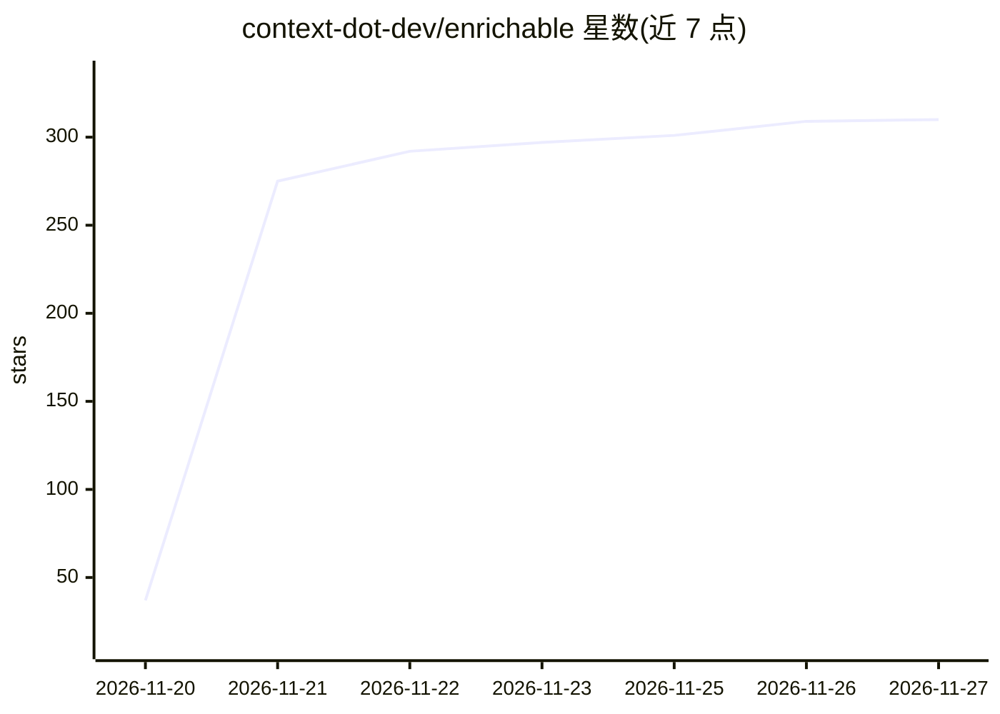

# context-dot-dev/enrichable

⭐ 310 · TypeScript · MIT · 推送 2026-11-24 · [GitHub](https://github.com/context-dot-dev/enrichable) · [官网](https://www.enrichable.io) · 组织维护

**面向销售/增长团队的 AI 表格：按提示生成名单并联网逐行调研**

开源的 AI 电子表格应用，用于数据富化：用自然语言描述目标公司或人群即可生成去重后的行（潜在客户名单），每列可用英文提问，由系统在实时网络上检索该行的定价页、CEO、技术栈、工作邮箱等公开信息，答案附带来源与置信度。内置 Hunter/Prospeo/Apollo/QuickEnrich/ContactOut 顺序尝试的工作邮箱瀑布流，支持校验列、Excel 式本地公式、邮件/PDF 草稿与 CSV/Excel/JSON 导出。要求 Context.dev 与 OpenAI 的 API key，数据存于 Neon Postgres；可用 MCP 客户端读写表格。

## 筛选速览

| 维度 | 判定 | 备注 |
|---|---|---|
| AI 角色 | `ai-native` | 本体是模型或模型工具 |
| 许可风险 | `permissive` | MIT |
| 部署形态 | `None` |  |
| 模型依赖 | — | README 未给出锁定关系 |
| 硬件要求 | — | 无带数字的原话,不猜 |
| 安装摩擦 | `low` | 无编译、无系统依赖或容器化 |
| 成熟度 | — | 结构信号不足 |

## 能力要点

- 自然语言生成行并按域名去重
- AI 研究列逐行联网检索并保留来源链接
- 多家邮箱服务商顺序尝试的邮箱瀑布流
- 提供 MCP server，Claude Code/Cursor 可读写并富化表格

## 适用场景

- 从一句话提示批量生成潜在客户名单
- 逐行调研公司定价、技术栈、高管等公开信息
- 按自定义顺序查找工作邮箱
- 通过 MCP 客户端程序化操作表格

## 场景标签

 · 领域:销售/营销数据工具

## 证据(README 行号)

> L21: **Enrichable is an open-source AI spreadsheet for data enrichment.** Describe the companies or people you want and 
> L39: 2. **Add AI columns.** Ask a question and reference other columns with `{{Website}}`. Enrichable picks the operatio
> L42: Context.dev handles the web (search, scraping, company and people data). OpenAI does the reasoning. TypeSafe makes 

## 星数曲线

2026-11-20 37 → 2026-11-27 310（+273）

---
*卡片 v1 · prompt 1.4 · 生成 2026-11-26 · 置信度 high · 依据 README sha `8ad305de976a` · [字段定义](../../DATASET.md)*
