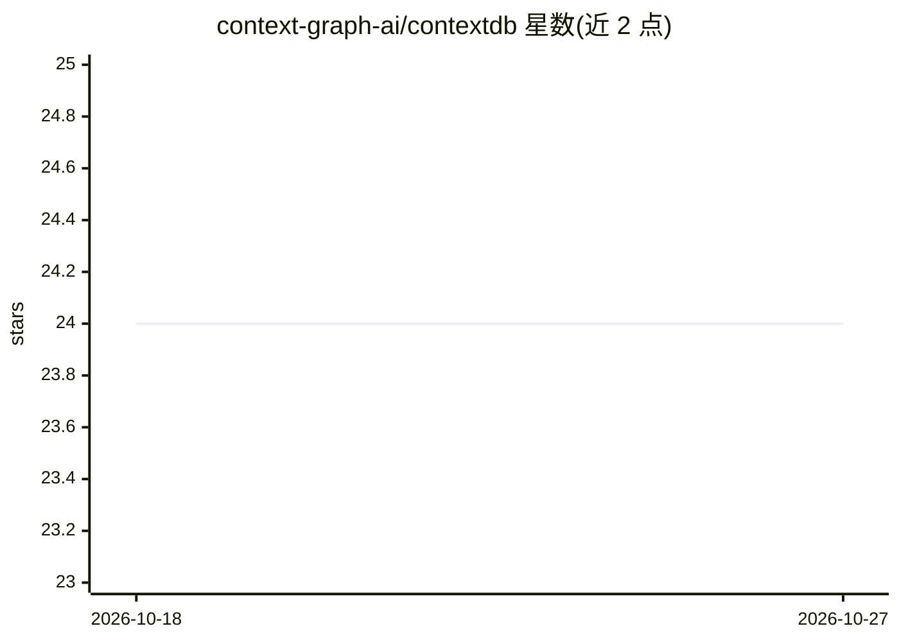

# context-graph-ai/contextdb

⭐ 24 · Rust · Apache-2.0 · 推送 2026-10-25 · [GitHub](https://github.com/context-graph-ai/contextdb) · [官网](https://contextdb.tech) · 组织维护

**面向 agentic memory 的嵌入式数据库：单文件统一关系/图/向量存储**

用 Rust 编写的嵌入式数据库，在单一文件、单进程中同时提供 PostgreSQL 兼容 SQL、SQL/PGQ 风格图查询（GRAPH_TABLE...MATCH）、pgvector 约定的向量相似度搜索（<=>），并由 MVCC 事务统一覆盖三种存储。面向构建 agent 记忆系统的开发者，替代 SQLite+向量库+应用层图遍历的组合。支持引擎强制的策略约束（STATE MACHINE、IMMUTABLE、DAG、PROPAGATE、TTL）、插件生命周期钩子、订阅提交事件，以及基于 iroh 的双向点对点同步与可选 SyncServer。限制：当前仅提供 Rust API 与 CLI，Python/TypeScript 绑定在路线图中；单写者模型。企业版将存储层切换到对象存储。

## 筛选速览

| 维度 | 判定 | 备注 |
|---|---|---|
| AI 角色 | `ai-ecosystem` | LLM/agent 周边工具 |
| 许可风险 | `permissive` | Apache-2.0 |
| 部署形态 | `self-host` | docker 或自建部署 |
| 模型依赖 | — | README 未给出锁定关系 |
| 硬件要求 | — | 无带数字的原话,不猜 |
| 安装摩擦 | `low` | 无编译、无系统依赖或容器化 |
| 成熟度 | — | 结构信号不足 |

## 能力要点

- 关系/图/向量三存储在同一事务与读快照下统一（MVCC）
- 引擎强制策略约束：状态机、DAG、不可变表、级联传播、TTL
- 基于加密身份的拨号式双向同步（iroh，LAN 免服务器，NAT 穿透）
- DatabasePlugin 生命周期钩子与订阅提交事件

## 适用场景

- 为 AI agent 构建本地记忆存储，避免拼接 SQLite、向量库与应用层图逻辑
- 多台设备间同步 agent 学到的知识且各自可独立离线运行
- 用数据库强制业务不变量（状态流转、无环依赖）而非应用代码

## 场景标签

`Agent 记忆` · 领域:Agent 开发

## 证据(README 行号)

> L10: An embedded database for agentic memory systems. Relational storage, graph traversal, and vector similarity search 
> L12: If you're building agent memory today, you're probably stitching together SQLite for state, a vector database for e

## 星数曲线

2026-10-18 24 → 2026-10-27 24（+0）

---
*卡片 v1 · prompt 1.4 · 生成 2026-10-27 · 置信度 mid · 依据 README sha `0bdd561a05a2` · [字段定义](../../DATASET.md)*
