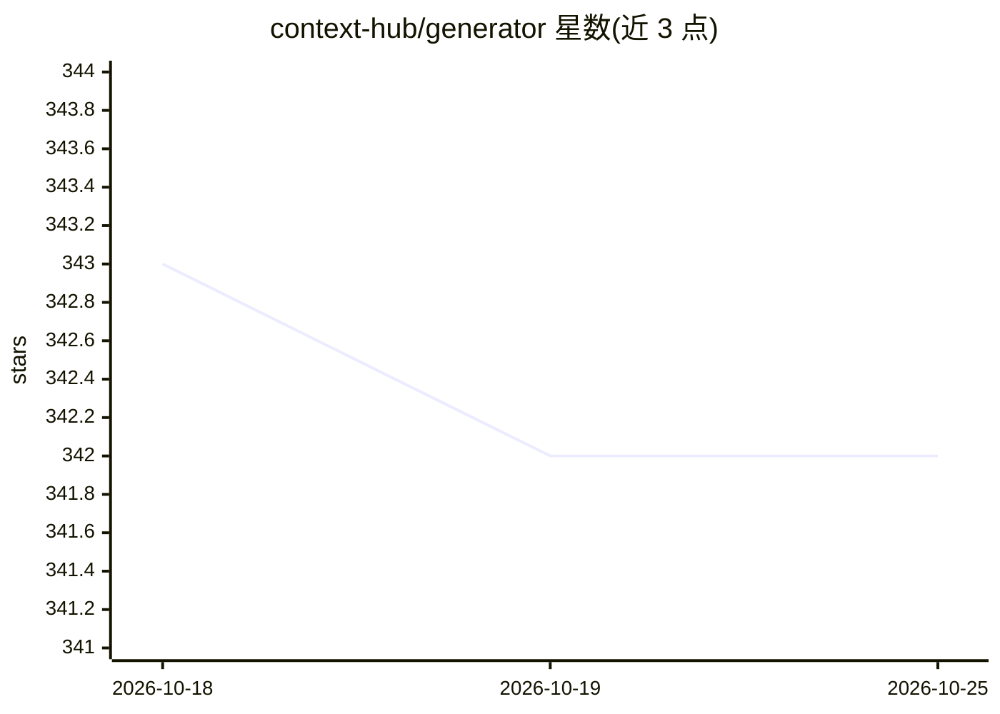

# context-hub/generator

⭐ 342 · PHP · MIT · 推送 2026-10-22 · [GitHub](https://github.com/context-hub/generator) · [官网](https://docs.ctxllm.com) · 组织维护

**给 AI 编程助手的 MCP 工具：让 AI 直接读写代码库**

单文件约 20MB、零依赖的二进制工具，以内置 MCP 服务器形式向 Claude Desktop、Cursor、Cline 等 MCP 客户端的 AI 提供文件读写、代码搜索、PHP 结构分析、目录探索等能力；支持通过 YAML 定义自定义命令（测试/部署/lint）交由 AI 执行、多项目管理和多仓库/URL/git diff 来源的上下文文档生成。提供 curl/PowerShell 下载脚本与 ctx mcp:config 自动配置，MIT 许可。

## 筛选速览

| 维度 | 判定 | 备注 |
|---|---|---|
| AI 角色 | `ai-ecosystem` | LLM/agent 周边工具 |
| 许可风险 | `permissive` | MIT |
| 部署形态 | `None` |  |
| 模型依赖 | — | README 未给出锁定关系 |
| 硬件要求 | — | 无带数字的原话,不猜 |
| 安装摩擦 | `low` | 无编译、无系统依赖或容器化 |
| 成熟度 | — | 结构信号不足 |

## 能力要点

- 单文件二进制，零运行时依赖，内置 MCP 服务器
- 文件读写/正则搜索/PHP 结构分析等 filesystem 工具
- YAML 自定义命令可让 AI 执行测试、部署、lint
- 从文件、git diff、GitHub 仓库、URL 生成结构化 markdown 上下文文档

## 适用场景

- 让 Claude Desktop/Cursor 中的 AI 直接在项目中读写与修改代码
- 跨多个微服务仓库同时开发贯穿性功能
- 生成含 git diff 与架构概览的上下文文档用于代码评审或新人上手

## 场景标签

`提示工程` · 领域:Agent 开发

## 证据(README 行号)

> L3: > MCP-powered development toolkit that gives AI full access to your codebase
> L16: **CTX** is a single ~20 MB binary with zero dependencies. No Node.js, no Python, no runtime — just download, connec
> L31: ### 🛠 MCP Server — AI Develops Directly in Your Project

## 星数曲线

2026-10-18 343 → 2026-10-25 342（-1）

---
*卡片 v1 · prompt 1.4 · 生成 2026-10-22 · 置信度 high · 依据 README sha `c0c6fcce45d4` · [字段定义](../../DATASET.md)*
