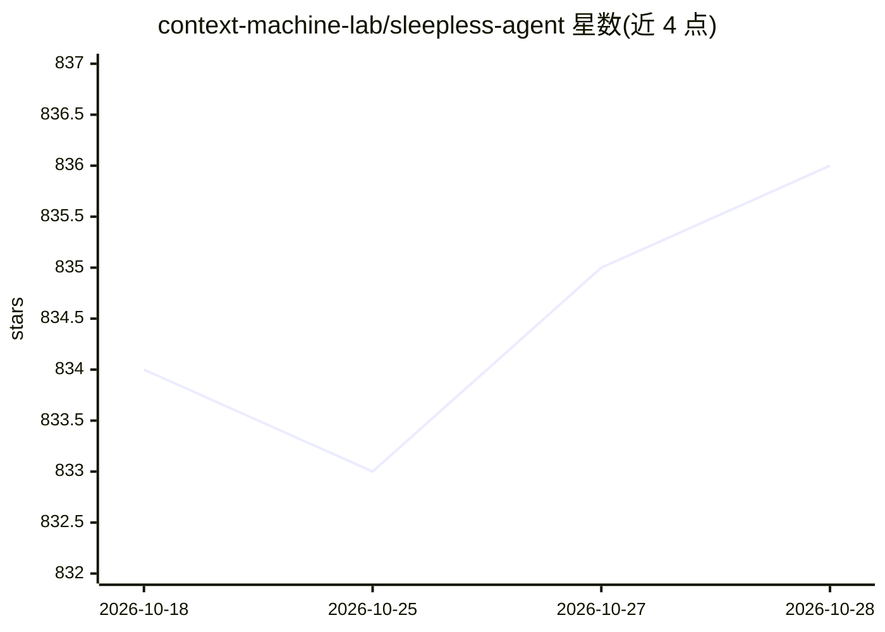

# context-machine-lab/sleepless-agent

⭐ 835 · Python · MIT · 推送 2026-03-29 · [GitHub](https://github.com/context-machine-lab/sleepless-agent) · [官网](https://context-machine-lab.github.io/sleepless-agent/) · 组织维护 · 中文 README

**让 Claude Code Pro 24/7 后台处理任务的 Slack/CLI 守护进程**

基于 Claude Code CLI 与 Python Agent SDK 的常驻任务处理守护进程：用户通过 Slack 斜杠命令或 sle CLI 提交随想与正式任务，任务进入 SQLite 队列，由 Planner/Worker/Evaluator 多 agent 在相互隔离的工作区中执行；自动进行 Git 提交、为正式任务创建 feature 分支与 PR，并按昼夜阈值监控 Claude Code 用量、达阈值暂停生成。Slack 为可选，全部功能可经 CLI 使用；需 Python 3.11+、Claude Code CLI 与 Git。

## 筛选速览

| 维度 | 判定 | 备注 |
|---|---|---|
| AI 角色 | `ai-ecosystem` | LLM/agent 周边工具 |
| 许可风险 | `permissive` | MIT |
| 部署形态 | `library` | 以包/库形式分发 |
| 模型依赖 | locked-api |  |
| 硬件要求 | — | 无带数字的原话,不猜 |
| 安装摩擦 | `medium` | 含编译或系统依赖之一 |
| 成熟度 | — | 结构信号不足 |

## 能力要点

- SQLite 持久化任务队列与优先级调度
- Planner/Worker/Evaluator 多 agent 工作流，每任务独立工作区
- 昼夜分时用量阈值监控，达阈值自动暂停与恢复
- Git 自动化：随想提交 thought-ideas 分支，正式任务自动建分支并开 PR

## 适用场景

- 夜间让 Claude Code Pro 自动消化积压的想法和任务
- 通过 Slack 随时提交任务并在专属线程与 Claude 对话
- 自动化开发任务并生成提交与 PR 供白天审阅

## 场景标签

`编码 Agent` `多智能体` · 领域:Agent 开发

## 证据(README 行号)

> L10: Have Claude Code Pro but not using it at night? Transform it into an AgentOS that handles your ideas and tasks whil
> L45: - 🔌 **Claude Code SDK**: Uses Python Agent SDK to interface with Claude Code CLI
> L290: - **claude_code_executor.py**: Python Agent SDK wrapper with isolated workspace management

## 星数曲线

2026-10-18 834 → 2026-10-28 836（+2）

---
*卡片 v1 · prompt 1.4 · 生成 2026-10-21 · 置信度 mid · 依据 README sha `d0c592ee71c5` · [字段定义](../../DATASET.md)*
