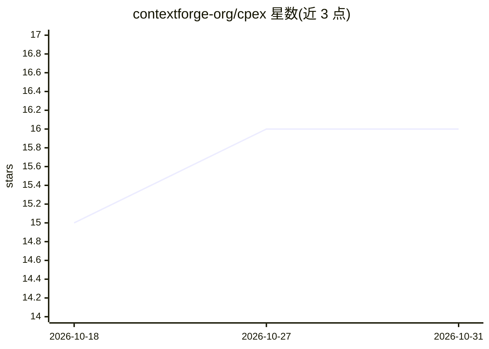

# contextforge-org/cpex

⭐ 16 · Rust · Apache-2.0 · 推送 2026-10-26 · [GitHub](https://github.com/contextforge-org/cpex) · [官网](https://contextforge-org.github.io/cpex) · 组织维护

**给 AI agent 开发者的策略执行运行时（Rust/Python/Go）**

CPEX 是面向 AI agent 的策略执行运行时，充当 agent 与其调用的各项能力（工具、提示、资源、推理提供方、A2A 方法）之间的确定性引用监视器。以 APL 配置定义执行管线，组合身份解析、授权、凭据委托（OAuth RFC 8693）、脱敏、信息流追踪与审计；可调用 Cedar/CEL/OPA/AuthZEN 作为决策点。可部署在工具服务器前、作为出口 sidecar 或框架内中间件。提供 Rust/Python/Go 三种 API；不自带审计或 PII 扫描插件。项目处于活跃开发阶段，Apache 2.0 许可。

## 筛选速览

| 维度 | 判定 | 备注 |
|---|---|---|
| AI 角色 | `ai-ecosystem` | LLM/agent 周边工具 |
| 许可风险 | `permissive` | Apache-2.0 |
| 部署形态 | `library` | 以包/库形式分发 |
| 模型依赖 | — | README 未给出锁定关系 |
| 硬件要求 | — | 无带数字的原话,不猜 |
| 安装摩擦 | `low` | 无编译、无系统依赖或容器化 |
| 成熟度 | `idea` | |

## 能力要点

- 确定性引用监视器：对 agent 每次操作执行统一的策略管线
- 跨操作信息流追踪与会话状态（污点传播，防止 write-down 类跨调用攻击）
- 可编排 Cedar/CEL/OPA/AuthZEN 等既有授权系统作为决策点
- Rust/Python/Go 三种语言 API，同一 APL 策略可跨网关、agent 与服务部署

## 适用场景

- 在 agent 调用 HR/代码库/邮件等后端时按身份执行差异化脱敏与授权
- 为 agent 跨信任边界的出口流量加策略执行点（egress sidecar）
- 在既有授权系统之上统一编排委托、审计与会话级信息流控制

## 场景标签

 · 领域:AI agent 安全/基础设施

## 证据(README 行号)

> L20: It acts as a deterministic reference monitor between an agent and every capability it invokes: tools, prompts, reso
> L160: The project is designed as a reusable enforcement layer for agentic systems, integrating with AI gateways, agent f

## 星数曲线

2026-10-18 15 → 2026-10-31 16（+1）

---
*卡片 v1 · prompt 1.4 · 生成 2026-10-30 · 置信度 high · 依据 README sha `4597df27e1cb` · [字段定义](../../DATASET.md)*
