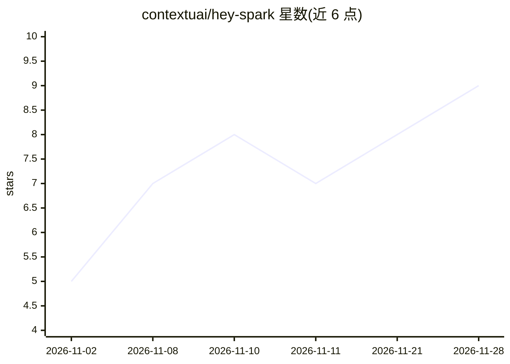

# contextuai/hey-spark

⭐ 9 · Python · NOASSERTION · 推送 2026-11-26 · [GitHub](https://github.com/contextuai/hey-spark) · [官网](https://contextuai.com) · 组织维护

**本地唤醒词语音助手：语音问答与工具调用**

面向笔记本电脑用户的常驻语音助手：说出 "Hey Spark" 后提问或下达命令，语音回答结果。唤醒词（openWakeWord）、语音识别（faster-whisper）与语音合成（Piper/Kokoro）在本地 CPU 运行；大脑可接 Claude（Claude Agent SDK）、Hermes Agent 或任意 OpenAI 兼容 API（含本地 Ollama）。通过 MCP 服务器连接 GitHub、Gmail 等工具，带白名单与口头确认机制。提供 macOS/Windows 桌面应用安装包，或用 uv 从源码运行。

## 筛选速览

| 维度 | 判定 | 备注 |
|---|---|---|
| AI 角色 | `ai-native` | 本体是模型或模型工具 |
| 许可风险 | `permissive` | NOASSERTION |
| 部署形态 | `desktop` | 安装包/桌面程序 |
| 模型依赖 | local-ok | 支持本地模型 |
| 硬件要求 | `cpu-ok` | |
| 安装摩擦 | `low` | 无编译、无系统依赖或容器化 |
| 成熟度 | — | 结构信号不足 |

## 能力要点

- 本地唤醒词、STT、TTS 全部 CPU 运行，也可选 Deepgram/ElevenLabs 云端后端
- MCP 连接器带分级工具策略：只读放行、副作用需口头确认、破坏性默认阻断
- 支持 barge-in 打断、追问免唤醒词、15 个内置短语快捷指令
- wake word/VAD/STT/TTS/brain 后端均可经 config.yaml 更换，无需改代码

## 适用场景

- 在笔记本上语音问答日历、定时器等日常事务
- 语音查读 GitHub 的 PR 与 issue 并创建项目仓库
- 用 Ollama 本地模型搭建全离线语音助手

## 场景标签

`AI 助手` `语音 Agent` · 领域:对话与助手

## 证据(README 行号)

> L13: **An always-listening voice assistant for your laptop.** Say *"Hey Spark"*, ask a question or
> L16: or any OpenAI-compatible model, including a local one through Ollama. Spark reaches your tools (GitHub, Gmail, Cale
> L35: - **Your choice of brain.** Claude through the

## 星数曲线

2026-11-02 5 → 2026-11-28 9（+4）

---
*卡片 v1 · prompt 1.4 · 生成 2026-11-20 · 置信度 high · 依据 README sha `d89a3598aee8` · [字段定义](../../DATASET.md)*
