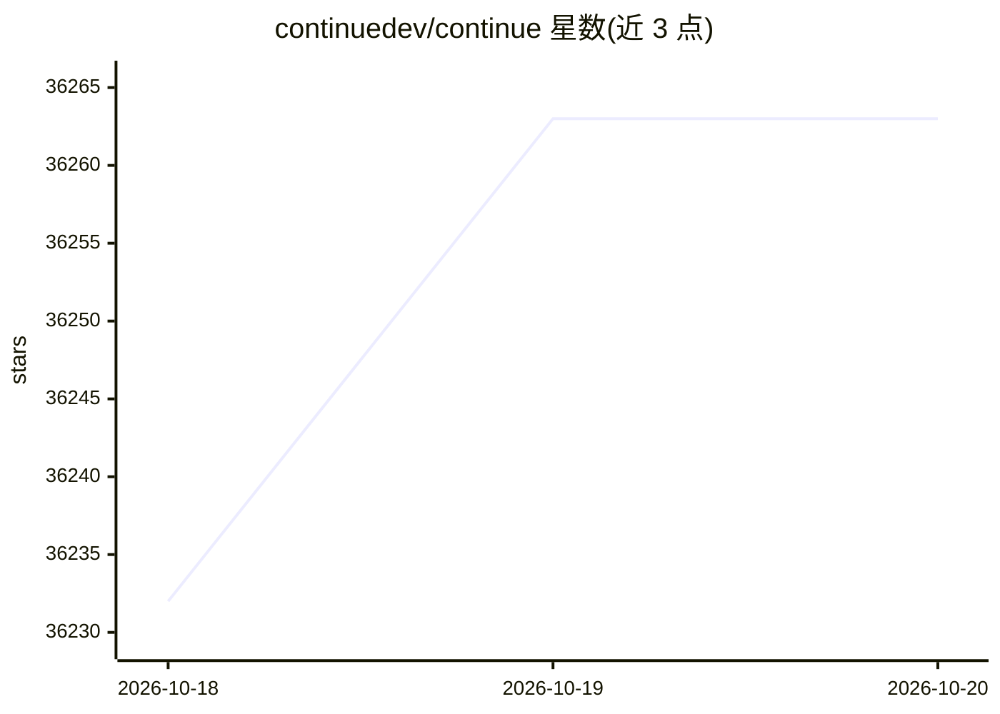

# continuedev/continue

⭐ 36,263 · TypeScript · Apache-2.0 · 推送 2026-10-18 · [GitHub](https://github.com/continuedev/continue) · [官网](https://continue.dev) · 组织维护

**面向开发者的开源编码代理：CLI、VS Code、JetBrains 三形态**

Continue 是一个编码代理，以 CLI、VS Code 扩展和 JetBrains 插件三种形态提供。仓库现处于只读状态、不再积极维护，团队发布了最终的 2.0.0 版本，该版本移除了匿名遥测与身份认证并修复了缺陷。各形态分发渠道：VS Code 扩展在 Marketplace 与 OpenVSX，CLI 通过 npm，JetBrains 插件通过 GitHub Releases；官方推荐改用 Continue CLI 而非 JetBrains 插件。配置与定制方法见 Continue Docs。

## 筛选速览

| 维度 | 判定 | 备注 |
|---|---|---|
| AI 角色 | `ai-native` | 本体是模型或模型工具 |
| 许可风险 | `permissive` | Apache-2.0 |
| 部署形态 | `None` |  |
| 模型依赖 | — | README 未给出锁定关系 |
| 硬件要求 | — | 无带数字的原话,不猜 |
| 安装摩擦 | `low` | 无编译、无系统依赖或容器化 |
| 成熟度 | — | 结构信号不足 |

## 动量与使用信号

- 维护:`active` — 距上次 push 3.3 天,年发版 100,393 位贡献者
- 涨星:近 1 天 **+2**(自 20261016 起算)

## 能力要点

- 以 CLI、VS Code 扩展、JetBrains 插件三种形态分发
- 最终 2.0.0 版本移除匿名遥测与认证
- JetBrains 插件经 GitHub Releases 分发
- Apache 2.0 许可

## 适用场景

- 在终端通过 CLI 使用编码代理
- 在 VS Code 或 JetBrains 中安装编码代理扩展

## 场景标签

`编码 Agent` · 领域:编码与开发

## 证据(README 行号)

> L3:  Pioneering open-source coding agent
> L11: Continue is a coding agent available as a CLI, VS Code extension, and JetBrains plugin.
> L9: > _Note: The `continuedev/continue` repository is no longer actively maintained and is read-only for all users._

## 星数曲线

2026-10-18 36,232 → 2026-10-20 36,263（+31）

---
*卡片 v1 · prompt 1.4 · 生成 2026-10-18 · 置信度 high · 依据 README sha `3bc0db4535c3` · [字段定义](../../DATASET.md)*
