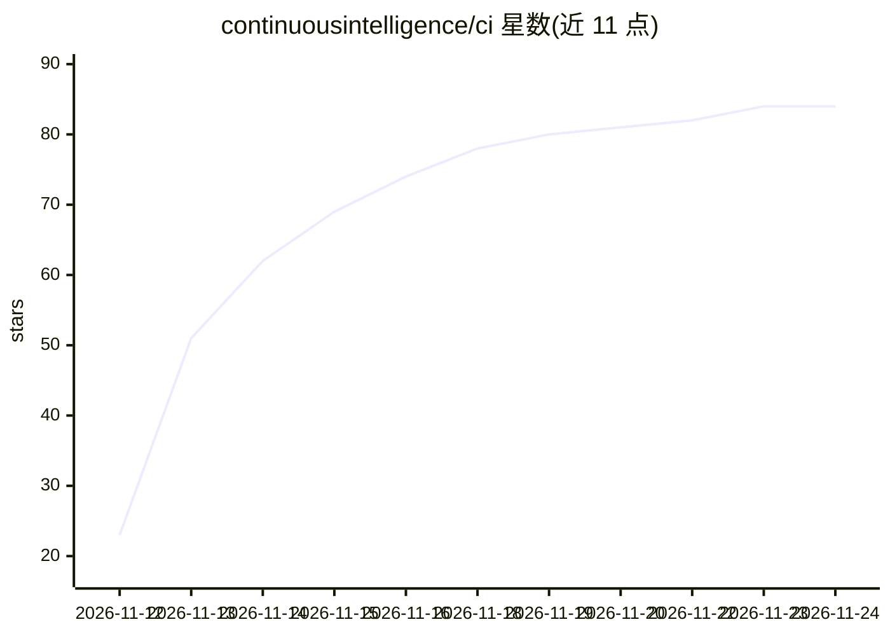

# continuousintelligence/ci

⭐ 84 · Python · NOASSERTION · 推送 2026-11-18 · [GitHub](https://github.com/continuousintelligence/ci) · [官网](https://www.continuousintelligence.co.uk) · 组织维护

**给开发者的时序基础模型：零配置概率预测，2M+ 步历史**

ci-proto 是一个时间序列预测基础模型，以 Python 包 continuousintelligence 提供，支持 CPU 与 GPU 运行。读取 PyTorch 张量、NumPy 数组、pandas DataFrame 或 CSV 作为历史数据，输出 0.1–0.9 九个分位数的多变量概率预测；支持协变量、类别输入、缺失值（NaN）处理，并通过长历史检查点处理超过 16,384 观测的序列。模型从 Hugging Face 仓库或本地 bundle 加载，可按 commit SHA 固定版本。Linux 下 pip 安装会带入 CUDA 版 PyTorch 与 Mamba-3 内核，融合推理需 Ampere 以上 GPU；CPU 路径为可移植 PyTorch 推理。声明在 fev-bench 上排名领先，并有下一代版本候补名单。

## 筛选速览

| 维度 | 判定 | 备注 |
|---|---|---|
| AI 角色 | `ai-native` | 本体是模型或模型工具 |
| 许可风险 | `none` | NOASSERTION |
| 部署形态 | `library` | 以包/库形式分发 |
| 模型依赖 | — | README 未给出锁定关系 |
| 硬件要求 | — | 无带数字的原话,不猜 |
| 安装摩擦 | `medium` | 含编译或系统依赖之一 |
| 成熟度 | `idea` | |

## 能力要点

- 2M+ 上下文窗口，超过 16,384 观测自动切换长历史检查点
- 输出 0.1–0.9 九个分位数，支持多变量与协变量/类别输入
- 同一 Python API 支持 CPU 与 GPU（CUDA 自动检测，CPU 回退）
- 支持 Hugging Face 仓库、本地 bundle 与 commit SHA 固定加载

## 适用场景

- 用历史需求/销售数据做多步概率预测
- 在含缺失值或带日历特征的序列上做预测
- 本地 CPU 或 GPU 环境零配置运行时序基础模型

## 场景标签

 · 领域:时间序列预测/深度学习

## 证据(README 行号)

> L4: # Introducing ci-proto, our frontier model that says goodbye to context windows and hello to accuracy
> L10: - **Frontier accuracy.** Leading forecasting performance on fev-bench.
> L11: - **CPU and GPU support.** Run locally through the same Python API.

## 星数曲线

2026-11-12 23 → 2026-11-24 84（+61）

---
*卡片 v1 · prompt 1.4 · 生成 2026-11-18 · 置信度 high · 依据 README sha `1a0dddee75aa` · [字段定义](../../DATASET.md)*
