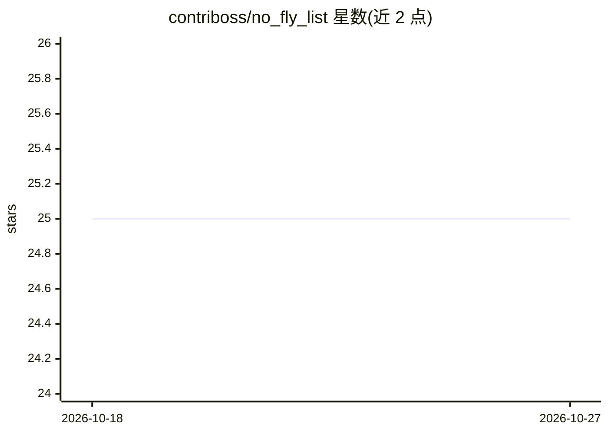

# contriboss/no_fly_list

⭐ 25 · Ruby · MIT · 推送 2026-10-19 · [GitHub](https://github.com/contriboss/no_fly_list) · 组织维护

**Rails 8.1+ 应用的标签系统 gem：多态标签与作用域标签**

面向 Rails 8.1+ 的 Ruby gem，通过 `include NoFlyList::TaggableRecord` 与 `has_tags` 为模型添加标签能力。支持多态共享标签或模型专属标签、多标签上下文、自定义 transformer 解析、标签数量与存在性限制、可选 counter cache、大小写敏感控制，以及按租户/实体的作用域标签实现多租户隔离。针对 PostgreSQL、MySQL、SQLite3 提供各自优化的查询策略。安装方式为 Gemfile 添加 gem 后 bundle install，再通过 rails generator 生成 transformer 与迁移文件。

## 筛选速览

| 维度 | 判定 | 备注 |
|---|---|---|
| AI 角色 | `ai-ecosystem` | LLM/agent 周边工具 |
| 许可风险 | `permissive` | MIT |
| 部署形态 | `None` |  |
| 模型依赖 | — | README 未给出锁定关系 |
| 硬件要求 | — | 无带数字的原话,不猜 |
| 安装摩擦 | `low` | 无编译、无系统依赖或容器化 |
| 成熟度 | — | 结构信号不足 |

## 能力要点

- 多态共享标签与模型专属标签两种模式
- scope 选项实现按租户/实体的标签隔离
- 针对 PostgreSQL/MySQL/SQLite3 的数据库特定查询优化
- 可配置 transformer 控制标签解析与分隔符

## 适用场景

- 为 Rails 应用中的文章、线索等模型添加标签分类
- 多租户 SaaS 中为每个租户维护独立标签集
- 对带标签记录做 with_any/with_all/with_exact 等查询

## 场景标签

 · 领域:Web 开发/数据库

## 证据(README 行号)

> L6: A modern, modular tagging system built specifically for Rails 8.1+ applications.
> L17: - **Modern Rails First**: Built specifically for Rails 8.1+, leveraging the latest Active Record features

## 星数曲线

2026-10-18 25 → 2026-10-27 25（+0）

---
*卡片 v1 · prompt 1.4 · 生成 2026-10-27 · 置信度 high · 依据 README sha `a5a84c3150e8` · [字段定义](../../DATASET.md)*
