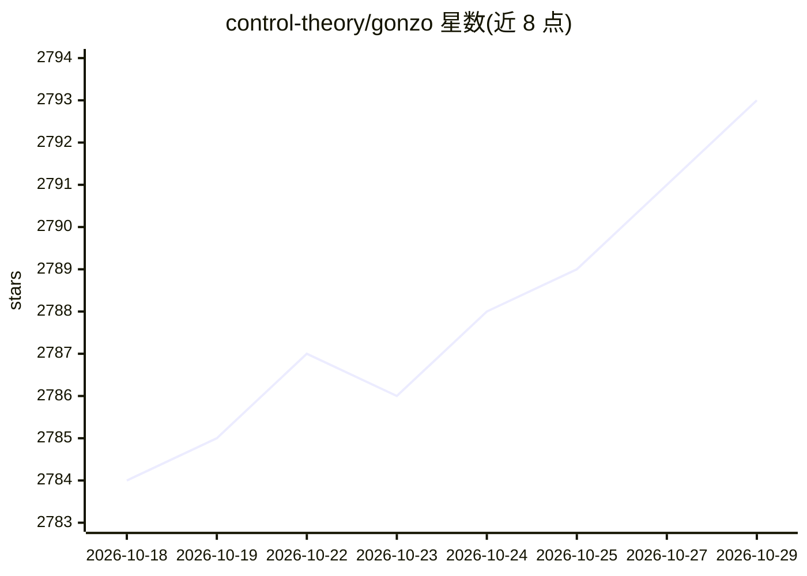

# control-theory/gonzo

⭐ 2,793 · Go · MIT · 推送 2026-09-23 · [GitHub](https://github.com/control-theory/gonzo) · [官网](https://www.controltheory.com/gonzo/) · 组织维护

**Go 编写的终端日志分析 TUI，支持 AI 洞察与 OTLP 接收**

受 k9s 启发的实时日志分析终端界面：从 stdin、文件、Kubernetes pod 流读取日志，内置 OTLP gRPC/HTTP 接收器，自动检测 JSON/logfmt/纯文本格式并支持 YAML 自定义格式；提供 2x2 面板、实时图表、正则与严重级别过滤。内嵌 React Web 仪表盘（Dstl8 Lite，端口 5718）。AI 功能为可选层：模式检测、异常分析、根因建议与日志对话，支持 OpenAI、Claude、LM Studio、Ollama 等 OpenAI 兼容 API，可完全离线运行本地模型。另附 Claude Code 插件与技能。

## 筛选速览

| 维度 | 判定 | 备注 |
|---|---|---|
| AI 角色 | `ai-enhanced` | 去掉 AI 部分产品仍成立 |
| 许可风险 | `permissive` | MIT |
| 部署形态 | `desktop` | 安装包/桌面程序 |
| 模型依赖 | local-ok | 支持本地模型 |
| 硬件要求 | — | 无带数字的原话,不猜 |
| 安装摩擦 | `low` | 无编译、无系统依赖或容器化 |
| 成熟度 | — | 结构信号不足 |

## 能力要点

- OTLP 一等支持：内置 gRPC/HTTP 接收器接收 OpenTelemetry 日志
- Kubernetes 集群 pod 日志流直连与命名空间/pod 过滤
- AI 分析为可选层：模式检测、异常分析、根因建议，支持本地模型离线运行
- 内嵌 Web 仪表盘 Dstl8 Lite（工作区、严重级别热图、Drain3 模式检测）

## 适用场景

- 在终端实时查看与过滤 Kubernetes 或应用日志流
- 把 OTLP 日志直接发到本地接收器做可视化分析
- 排查故障时用 AI 对日志做模式与根因分析

## 场景标签

`数据分析` · 领域:效率与自动化

## 证据(README 行号)

> L15: A powerful, real-time log analysis terminal UI inspired by k9s. Analyze log streams with beautiful charts, AI-power
> L78: - **AI analysis** - Get intelligent insights about log patterns and anomalies with configurable models
> L114: - **Multiple providers** - Works with OpenAI, Claude Code, LM Studio, Ollama, or any OpenAI-compatible API

## 星数曲线

2026-10-18 2,784 → 2026-10-29 2,793（+9）

---
*卡片 v1 · prompt 1.4 · 生成 2026-10-21 · 置信度 high · 依据 README sha `808d5c9e5ef8` · [字段定义](../../DATASET.md)*
