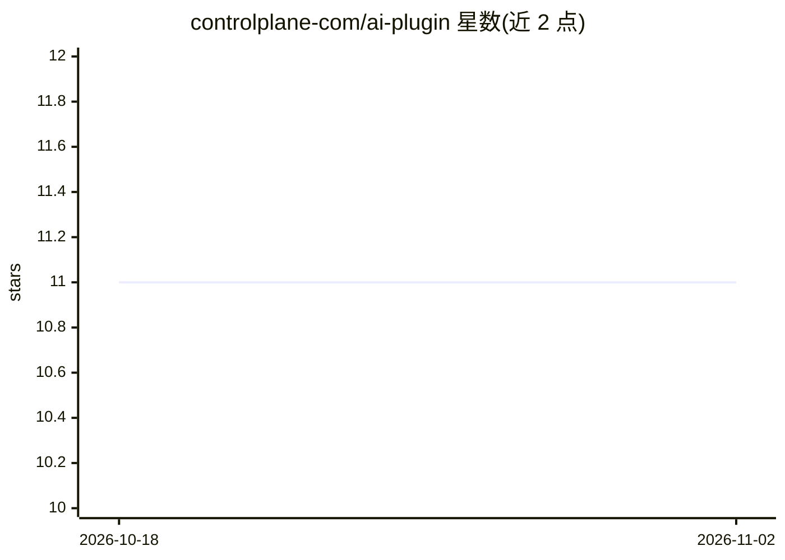

# controlplane-com/ai-plugin

⭐ 11 · Shell · MIT · 推送 2026-10-29 · [GitHub](https://github.com/controlplane-com/ai-plugin) · [官网](https://controlplane.com) · 组织维护

**给 Claude Code/Codex 等 AI 助手的 Control Plane 云工作负载管理插件**

Control Plane 官方发布的 AI 助手插件：将领域技能、生产护栏和托管 MCP 工具加载进 Claude Code、Codex、Antigravity CLI 及通用 MCP 客户端，使助手能用核验过的 cpln 命令在 AWS/GCP/Azure/OCI 及自有硬件上部署、排障、加固和迁移容器化工作负载。认证采用 OAuth 2.1 + PKCE，token 按组织作用域限制；破坏性操作需显式确认，插件本身不存储日志、密钥或遥测。包含跨 CLI 使用、访问控制、自动扩缩、网络、迁移等领域的技能与两个引导式 agent（排障、K8s/Compose/Helm 迁移）。

## 筛选速览

| 维度 | 判定 | 备注 |
|---|---|---|
| AI 角色 | `ai-ecosystem` | LLM/agent 周边工具 |
| 许可风险 | `permissive` | MIT |
| 部署形态 | `None` |  |
| 模型依赖 | — | README 未给出锁定关系 |
| 硬件要求 | — | 无带数字的原话,不猜 |
| 安装摩擦 | `low` | 无编译、无系统依赖或容器化 |
| 成熟度 | — | 结构信号不足 |

## 能力要点

- 支持 Claude Code、Codex、Antigravity CLI 与通用 MCP 客户端四种接入方式
- MCP OAuth 2.1 + PKCE 认证，token 按组织作用域服务端强制执行
- 破坏性操作需显式确认，密钥值不经聊天通道传输
- 两个引导式 agent：工作负载排障与 Kubernetes/Compose/Helm 迁移

## 适用场景

- 用自然语言让 AI 助手排查生产工作负载重启问题
- 让助手把 kustomization/Helm 配置迁移到 Control Plane 并部署
- 通过对话配置自动扩缩、网络入口、无凭据访问与高可用 Postgres

## 场景标签

 · 领域:云原生/DevOps 工具

## 证据(README 行号)

> L9: Run containerized workloads across AWS, GCP, Azure, OCI, and your own hardware under one API. It loads Control Plane
> L51: Point any other MCP client at the hosted server:
> L98: - Pre-configured access to the hosted Control Plane MCP server.

## 星数曲线

2026-10-18 11 → 2026-11-02 11（+0）

---
*卡片 v1 · prompt 1.4 · 生成 2026-11-02 · 置信度 high · 依据 README sha `95f9ea7442a8` · [字段定义](../../DATASET.md)*
