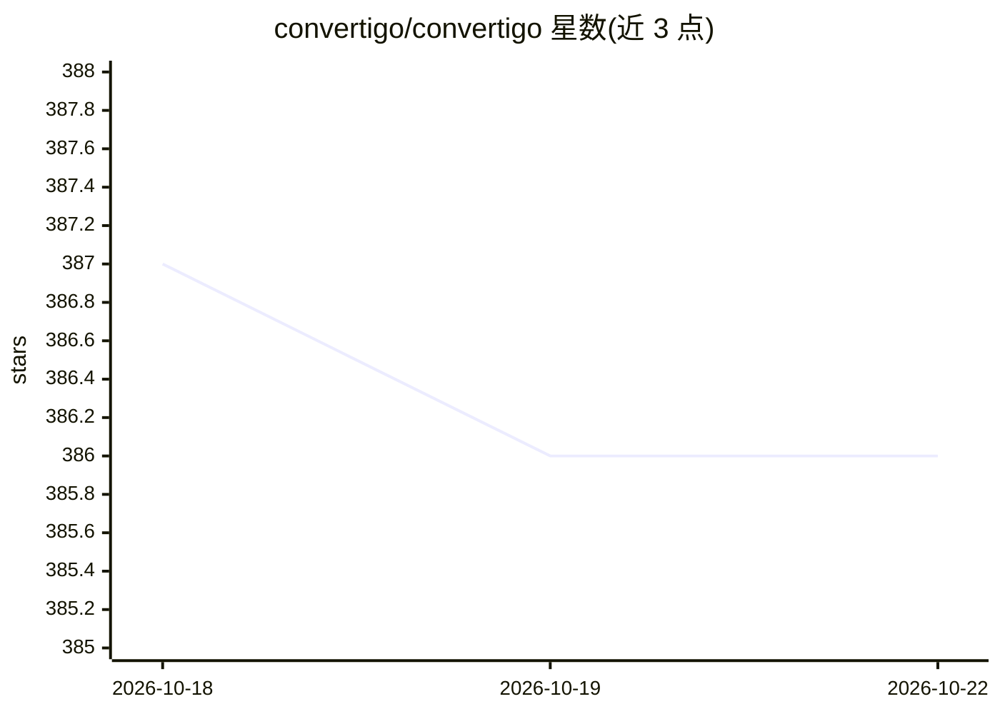

# convertigo/convertigo

⭐ 386 · Java · AGPL-3.0 · 推送 2026-10-22 · [GitHub](https://github.com/convertigo/convertigo) · [官网](https://www.convertigo.com) · 组织维护

**面向企业的开源低代码/无代码应用开发平台，含 AI 能力**

Convertigo Community Edition 是全栈低代码/无代码平台，用于构建跨平台企业级 Web 与移动应用并提供后端即服务。由 Server（Docker/HELM/WAR 部署，处理后端连接器、微服务、离线数据同步）、基于 Eclipse 的 Studio（低代码编写微服务工作流与 Mobile Builder 构建 UI）和面向非技术人员的 Web 端 No Code Studio（构建 PWA/表单应用）三部分组成。README 标注 AI Driven 与 MCP Server、AI Agents 徽章，称被 15 万以上开发者使用。许可为 AGPL。

## 筛选速览

| 维度 | 判定 | 备注 |
|---|---|---|
| AI 角色 | `ai-enhanced` | 去掉 AI 部分产品仍成立 |
| 许可风险 | `viral` | AGPL-3.0 |
| 部署形态 | `self-host` | docker 或自建部署 |
| 模型依赖 | — | README 未给出锁定关系 |
| 硬件要求 | — | 无带数字的原话,不猜 |
| 安装摩擦 | `low` | 无编译、无系统依赖或容器化 |
| 成熟度 | — | 结构信号不足 |

## 能力要点

- Server 以容器（DockerHub）、HELM Chart 或 Tomcat WAR 三种形式部署
- Eclipse 基座 Studio 支持低代码构建 Web/Mobile 应用 UI 与后端微服务工作流
- Web 端 No Code Studio 面向公民开发者构建 PWA/表单应用
- 后端提供连接器、微服务执行与设备离线数据同步

## 适用场景

- 企业团队快速构建跨平台移动与 Web 应用
- 非技术人员用无代码方式搭建表单类 PWA 应用
- 以容器或 Kubernetes 方式部署企业应用后端

## 场景标签

 · 领域:企业低代码应用开发平台

## 证据(README 行号)

> L2: > Convertigo is an open source AI Driven Low code & No Code platform for business application development and back-e
> L8: Convertigo Community edition is an open source fullstack Low Code & No Code platform. The platform is used to build 

## 星数曲线

2026-10-18 387 → 2026-10-22 386（-1）

---
*卡片 v1 · prompt 1.4 · 生成 2026-10-21 · 置信度 mid · 依据 README sha `3df6a17032f9` · [字段定义](../../DATASET.md)*
