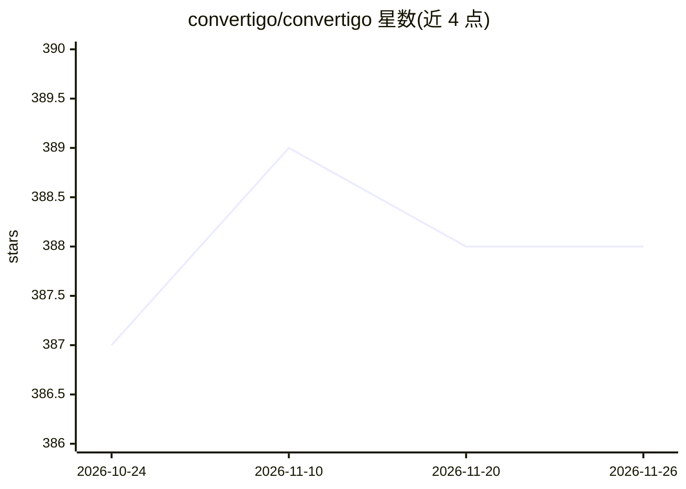

# convertigo/convertigo

⭐ 388 · Java · AGPL-3.0 · 推送 2026-11-25 · [GitHub](https://github.com/convertigo/convertigo) · [官网](https://www.convertigo.com) · 组织维护

**低代码/无代码全栈企业应用构建与自托管平台**

Convertigo Community Edition 是开源的 Low Code 与 No Code 平台，用于构建并自托管企业级 Web、移动与 PWA 应用。平台由三部分组成：Convertigo Server（后端连接器、微服务执行、离线数据同步，以 Docker 容器、HELM Chart 或 Tomcat WAR 提供）、基于 Eclipse 的 Convertigo Studio（Windows/macOS 桌面 IDE，编写后端微服务工作流与移动应用 UI）、面向非技术人员的 No Code Studio（表单类应用构建）。README 另列出 AI Knowledge Center 与 MCP Server、AI Agents 相关条目，采用 AGPL 许可。

## 筛选速览

| 维度 | 判定 | 备注 |
|---|---|---|
| AI 角色 | `ai-enhanced` | 去掉 AI 部分产品仍成立 |
| 许可风险 | `viral` | AGPL-3.0 |
| 部署形态 | `self-host` | docker 或自建部署 |
| 模型依赖 | — | README 未给出锁定关系 |
| 硬件要求 | — | 无带数字的原话,不猜 |
| 安装摩擦 | `low` | 无编译、无系统依赖或容器化 |
| 成熟度 | — | 结构信号不足 |

## 能力要点

- 三组件架构：Server（后端/微服务/同步）、Studio（Eclipse IDE）、No Code Studio（公民开发者）
- 支持 Docker 容器、HELM Chart 与 Tomcat WAR 部署
- README 提及 MCP Server 与 AI Agents、AI Knowledge Center
- AGPL 开源许可，由 Convertigo SA 维护

## 适用场景

- 几天内构建企业级跨平台移动与 Web 应用
- 非技术人员用无代码方式搭建表单类 PWA 应用
- 通过 Kubernetes/HELM 自托管后端服务与数据同步

## 场景标签

 · 领域:企业应用开发/低代码平台

## 证据(README 行号)

> L8: Convertigo Community edition is an open source fullstack Low Code & No Code platform. The platform is used to build 
> L12: 3.	**Convertigo No Code Studio**: The No Code App Builder to build form based apps as PWAs or Web applications with

## 星数曲线

2026-10-24 387 → 2026-11-26 388（+1）

---
*卡片 v1 · prompt 1.4 · 生成 2026-11-25 · 置信度 mid · 依据 README sha `483148d53037` · [字段定义](../../DATASET.md)*
