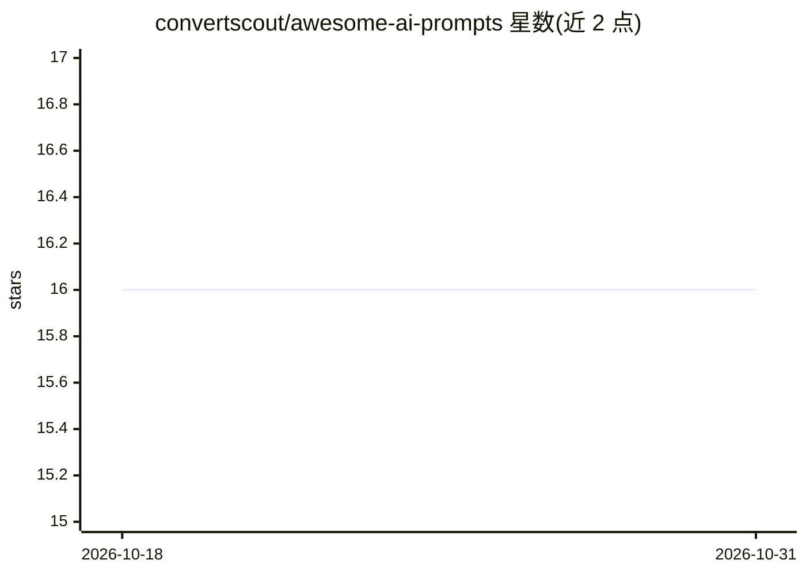

# convertscout/awesome-ai-prompts

⭐ 16 · TypeScript · MIT · 推送 2026-02-11 · [GitHub](https://github.com/convertscout/awesome-ai-prompts) · [官网](https://lovabledirectory.site/) · 组织维护

**AI 编程提示词策展清单：206+ 条面向主流 AI 编码工具**

一个 awesome-list 形式的提示词集合，收录 206+ 条可复制的编程提示词，按目标工具分栏（Cursor、Lovable、Claude、ChatGPT、GitHub Copilot、Gemini），另按认证、UI/UX、数据与 API、性能等类别组织条目。每条目附描述与标签，README 链接到配套 Web 应用（lovabledirectory.site），可浏览、搜索并用 AI 生成自定义提示词（每日免费 3 次）。接受社区 PR 贡献，MIT 许可。

## 筛选速览

| 维度 | 判定 | 备注 |
|---|---|---|
| AI 角色 | `ai-knowledge` | 知识聚合/清单类 |
| 许可风险 | `permissive` | MIT |
| 部署形态 | `None` |  |
| 模型依赖 | — | README 未给出锁定关系 |
| 硬件要求 | — | 无带数字的原话,不猜 |
| 安装摩擦 | `low` | 无编译、无系统依赖或容器化 |
| 成熟度 | — | 结构信号不足 |

## 能力要点

- 206+ 条按 6 个 AI 工具分栏的编程提示词
- 认证/UI/数据 API/性能等类别索引
- 配套 Web 应用支持搜索与 AI 生成自定义提示词（每日免费 3 次）
- 开放 PR 贡献流程

## 适用场景

- 为 Cursor 或 Claude 查找现成的编码规则与提示词
- 按类别（认证、UI、性能等）检索提示词
- 用生成器定制缺少的提示词

## 场景标签

`提示工程` `精选清单` · 领域:Agent 开发

## 证据(README 行号)

> L3:  A curated collection of 206+ copy-paste prompts for Cursor, Lovable, Claude, ChatGPT, GitHub Copilot & more
> L21: （目录 8 行略）

## 星数曲线

2026-10-18 16 → 2026-10-31 16（+0）

---
*卡片 v1 · prompt 1.4 · 生成 2026-10-30 · 置信度 high · 依据 README sha `0b803e5b6696` · [字段定义](../../DATASET.md)*
