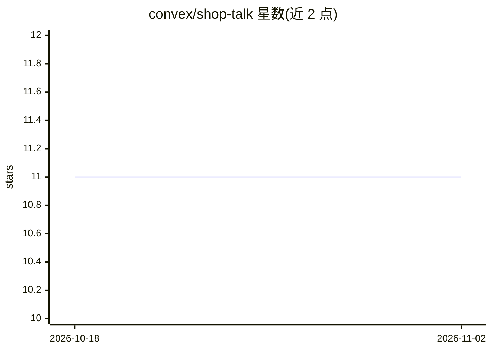

# convex/shop-talk

⭐ 11 · TypeScript · MIT · 推送 2026-02-05 · [GitHub](https://github.com/convex/shop-talk) · [官网](https://convex-shop-talk.vercel.app) · 组织维护

**实时协作购物清单演示应用：展示 daily-bots 语音与 Convex 后端集成**

由 Convex 维护的演示项目：一个实时协作购物清单 Web 应用，功能包括多人实时同步清单（基于 Convex 后端）、通过 daily-bots 实现的语音交互，前端使用 React、Tailwind CSS 与 Vite 构建。开发运行需配置 DAILY_BOTS_KEY 与 OPENAI_API_KEY 环境变量，使用 bun 安装依赖并分别启动前端与 Convex 开发服务。代码分为前端、Convex 后端函数、语音集成与购物清单组件四个目录。

## 筛选速览

| 维度 | 判定 | 备注 |
|---|---|---|
| AI 角色 | `ai-enhanced` | 去掉 AI 部分产品仍成立 |
| 许可风险 | `permissive` | MIT |
| 部署形态 | `None` |  |
| 模型依赖 | — | README 未给出锁定关系 |
| 硬件要求 | — | 无带数字的原话,不猜 |
| 安装摩擦 | `low` | 无编译、无系统依赖或容器化 |
| 成熟度 | — | 结构信号不足 |

## 能力要点

- 实时协作购物清单与数据同步（Convex）
- daily-bots 驱动的语音交互能力
- React + Tailwind CSS + Vite 前端

## 适用场景

- 学习 daily-bots 语音能力与 Convex 后端的集成方式
- 作为实时协作购物清单应用的参考实现

## 场景标签

`语音 Agent` · 领域:对话与助手

## 证据(README 行号)

> L3: A real-time collaborative shopping list application that demonstrates the integration of voice capabilities using da
> L8: - Voice interaction capabilities powered by daily-bots

## 星数曲线

2026-10-18 11 → 2026-11-02 11（+0）

---
*卡片 v1 · prompt 1.4 · 生成 2026-11-02 · 置信度 high · 依据 README sha `7328856427c8` · [字段定义](../../DATASET.md)*
